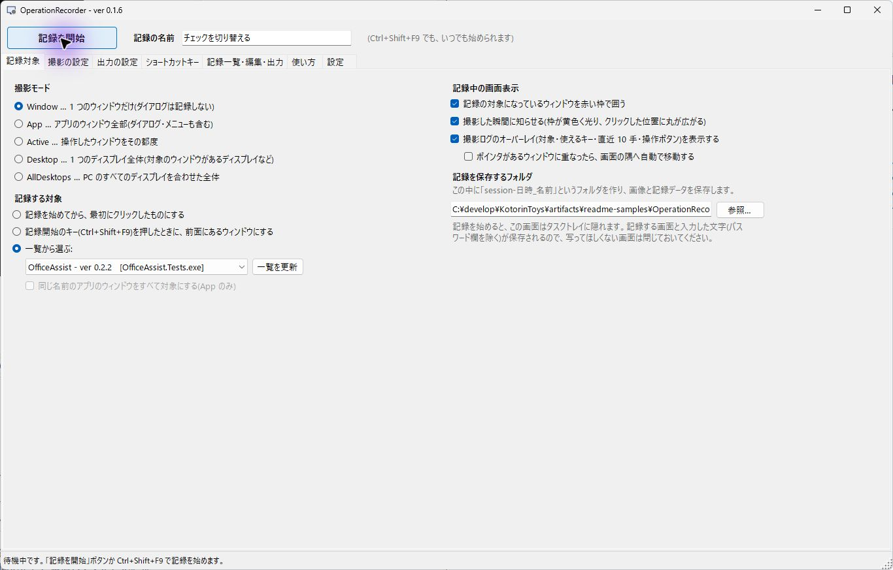
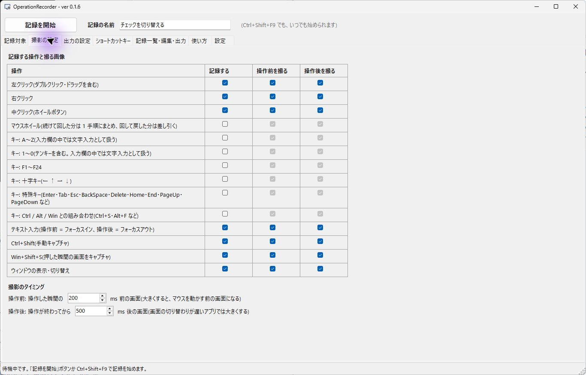
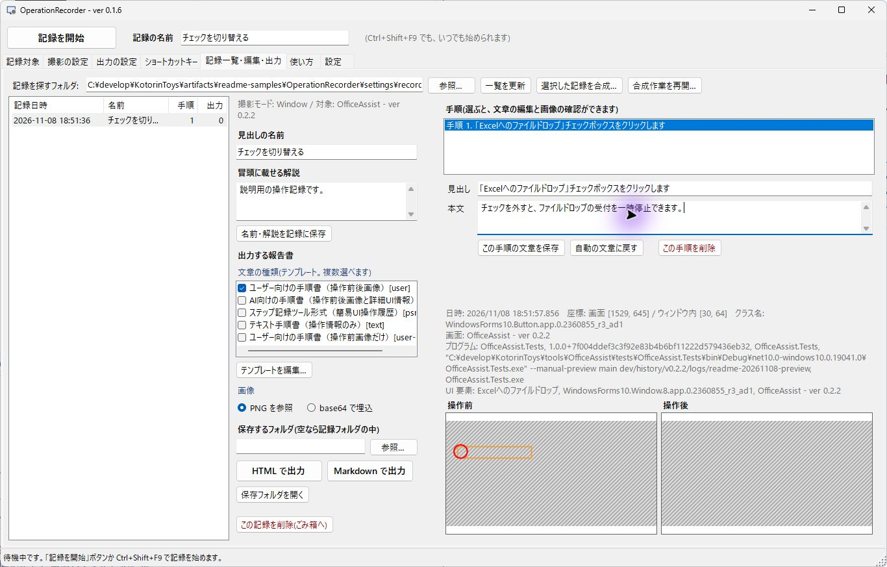
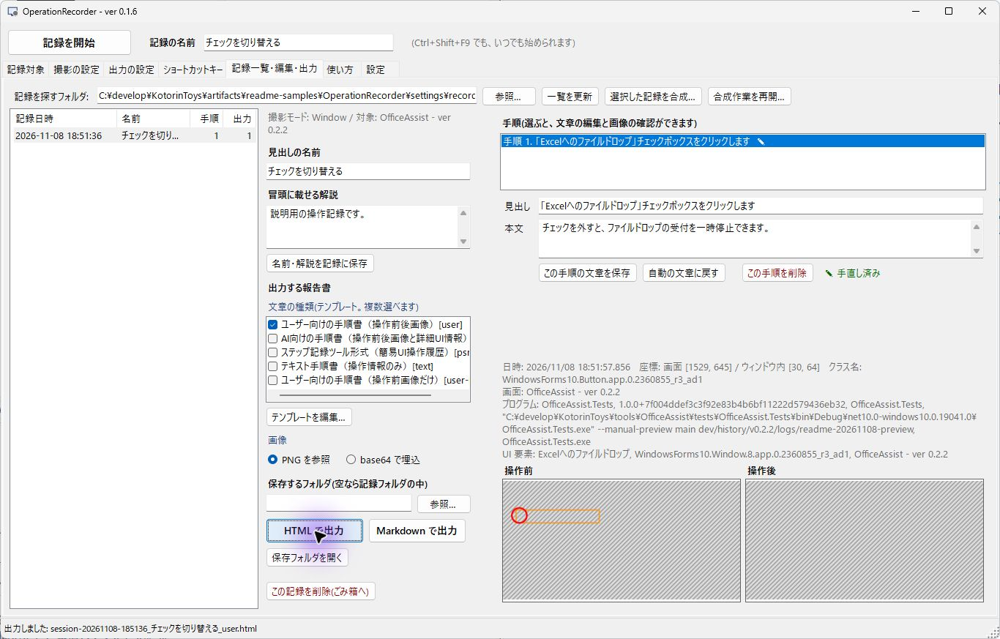
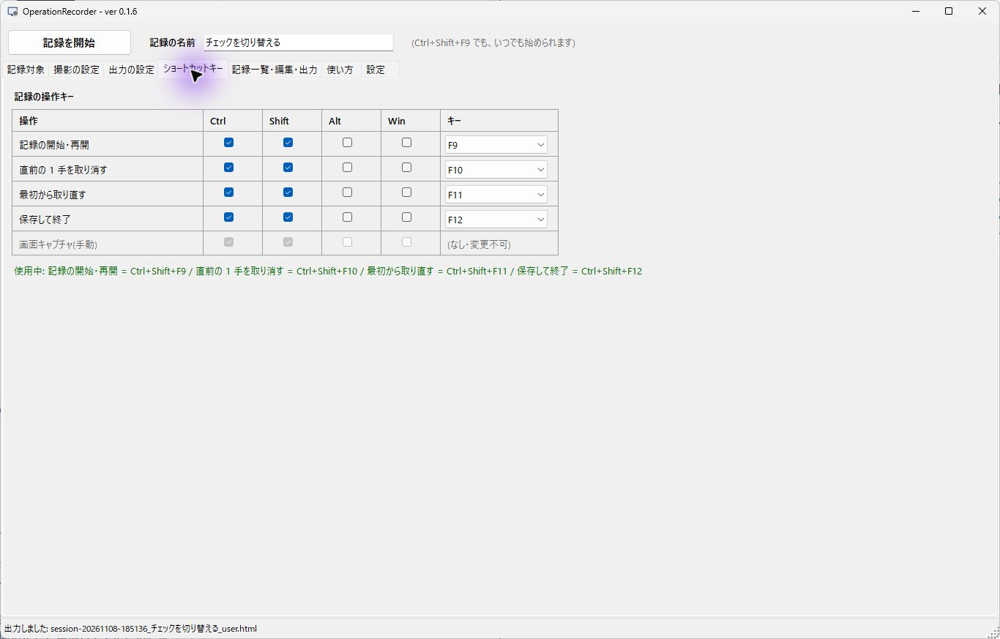

# OperationRecorder

[製品版の番号と訂正履歴](docs/version-numbering.md)

PC の操作を記録して、スクリーンショット付きの操作手順書(md)を作るデスクトップアプリ。
このリポジトリ内の `operation-recorder/` にある記録エンジンとテンプレートを使用する。
KotorinToysのコレクションからインストール・起動・表示・停止ができる。配布物はGitHub Releasesから入手できる。
記録をconfigへ変換し、条件を監視しながら操作を再現する[リプレイ](docs/replay.md)も利用できる。
対象の名前やクラスが変わる場合は、[複数記録からCodex CLIで条件を作成](docs/replay-learning.md)できる。

- KotorinToysからの起動と管理: [連携ガイド](docs/kotorintoys-integration.md)
- 使い方(利用者向け): [操作記録マニュアル](operation-recorder/MANUAL.md)
- 開発用のショートカット一覧: [config/shortcuts.json](config/shortcuts.json)（既定値。実際のキーはアプリ内で変更可能）
- 本体対応インストーラーの入手: [GitHub Releases](https://github.com/KotorinChunChun/OperationRecorder/releases)。KotorinToysからは公開カタログを更新し、「インストール」を選ぶ。
- 配布に含む第三者ソフトウェア: [配布通知](THIRD-PARTY-NOTICES.md)
- インストーラー作成・公開の手順: [リリース手順](docs/release.md)
- 全機能のコマンドライン試験とケース一覧: [自動テスト](docs/testing.md)

## 動画ではなく静止画で記録する理由

画面を動画で残して後から必要な場面を切り出す方法は、撮影のタイミングを後で調整できるため実用的に思える。
OperationRecorderは、次の理由から操作した瞬間の前後だけを静止画(PNG)で記録する。

- **自由な解像度の変化に対応できる。** 動画は記録を始めたときの範囲・解像度に縛られる。静止画は 1 枚ずつ、
  その時点の対象の範囲と解像度で撮るので、途中でウィンドウの大きさ・ディスプレイの拡大率・ディスプレイの構成が
  変わっても、そのまま残せる。
- **容量や処理コストが軽い。** 残すのは操作の前後の画面だけで、何も操作していない間の記録は要らない
  (直近 1.5 秒ぶんの画面をメモリに持つだけで、操作が無ければ捨てる)。長い作業を記録しても、ファイルの量は
  手順の数に比例するだけで、動画のエンコード・デコードの重い処理も要らない。
- **画質が劣化しない。** 可逆圧縮の PNG で保存するので、文字の細部まで撮ったときの完璧な状態の画像が残る。
  動画の非可逆圧縮のような、文字のにじみやブロックノイズが無い。

静止画で記録するときも、撮影のタイミングや出力する内容を調整できる。

| 後から変えたいこと | 対応 |
|---|---|
| 操作の何 ms 前・何 ms 後の画面にするか | 「撮影の設定」タブで決める(直近の画面をメモリに持っているので、操作より前の画面も撮れる) |
| マウスポインタ・クリック位置の丸・ドラッグの矢印・部品の枠 | 画像には描かずに保存し、出力するときに操作ログ(座標・部品の位置)から合成する。何度でも描き方を変えて出力し直せる |
| 中断・取り直しで記録が分かれた | 複数の記録から手順を選び、重複選択・差し込み・並べ替え・除外をして合成する。作業を途中保存し、元の記録を残した新しい記録に仕上げる |
| 手順の文章・要らない手順 | 記録一覧で直す・消す(記録そのものは書き換えず、出力するときに反映する) |

## 画面で見る操作

以下は0.1.6の画面です。説明用の設定とOfficeAssistのプレビュー画面を使っています。

### 1. 対象を選ぶ

「記録対象」で撮影モードと対象を選び、記録の名前を入力します。画面の例では、1つのウィンドウだけを記録するWindowモードを選んでいます。「記録を開始」を押すと、この画面は隠れます。



### 2. 撮影条件を確認する

「撮影の設定」で、記録する操作と操作前後の画像を選びます。キー入力やデスクトップ全体を記録すると、意図しない情報も残るため、必要な対象だけを選んでください。



### 3. 記録に説明を加える

対象画面を操作し、Ctrl+Shift+F12で保存します。「記録一覧・編集・出力」で記録と手順を選び、本文を補足して「この手順の文章を保存」を押します。



### 4. 手順書を出力する

テンプレートを選び、「HTMLで出力」または「Markdownで出力」を押します。画面下部の出力完了表示を確認し、「保存フォルダを開く」から成果物を確認できます。



画像の斜線は、対象を覆う別ウィンドウなどの写り込みを防いだ領域です。例では操作の記録・文章編集・出力を説明しています。対象の画面内容も残したい場合は、重なったウィンドウを避けて記録し直してください。

### 5. 操作キーを確認する

「ショートカットキー」で開始・取消・取り直し・保存終了のキーを確認できます。変更するときは他アプリと重複しない組合せを選びます。



開発に参加する場合は[開発者ガイド](docs/DEVELOPERS_GUIDE.md)を参照してください。

## ソースの構成

| ファイル | 内容 |
|---|---|
| `Program.cs` | 起動(同時に 1 つだけ。`--settings` で設定の画面、`--startup` でトレイに常駐して起動、`--record` ですぐ記録、`--export` は画面を出さずに出力) |
| `LaunchOptions.cs` | 起動の引数と起動済みのときの動き(`LaunchOptions`)、起動中のアプリへの合図(`InstanceSignal`。名前付きイベント)、旧スタートアップ登録の検出 |
| `ExportCommand.cs` | `--export`(画面を出さずに、記録フォルダから md / HTML を出力する) |
| `OutputChoices.cs` | 「出力する報告書」のテンプレートの一覧と表示(画像の並べ方はテンプレートの `{{images.…}}` で決める) |
| `OverlayPlacement.cs` | オーバーレイが、ポインタのあるウィンドウから逃げるときの行き先の計算 |
| `TemplateStore.cs` / `TemplateEditorForm.cs` | テンプレートのエディタ(追加・削除・書き方の確認・保存・プレビューは TemplateStore、画面は受け渡しだけ) |
| `MergeForm*.cs` | 複数記録の合成画面。候補比較・挿入・移動・採否・文章編集・Undo/Redo・途中保存と再開 |
| `UiTexts.cs` | 画面・トレイ・通知の文字のうち、操作キーの設定で変わるもの |
| `MainForm.HotkeysTab.cs` | 「ショートカットキー」タブ(操作キーの変更。判定は記録エンジンの `HotkeySet.Validate`) |
| `MainForm*.cs` | 画面(記録する / 記録一覧・md 出力 / 使い方 / 設定)とタスクトレイ |
| `RecordingController.cs` | 記録 1 件の開始〜保存(ホットキー待ち・保存・md 出力・取り直し) |
| `RecordingRuntime.cs` / `AppInteraction.cs` | 記録OS境界と確認・ファイル選択・外部起動等の差替え。自動試験から通常環境を変更しない |
| `AutomationCommand.cs` / `BasicAutomation.cs` / `CompositionAutomation.cs` | 実EXEからJSONシナリオを実行し、共通サービスと編集セッションの結果・終了コードを返す |
| `CompositionEditingSession.cs` | GUIとCLI共通の合成命令、入力中文章、Undo/Redo、途中保存と閉じる判断 |
| `AppSettings.cs` | 設定(`%APPDATA%\OperationRecorder\settings.json`)と、前の版の設定からの移行(`FromJson`) |
| `ShortcutInstaller.cs` | スタートメニューへの登録・解除(このユーザーだけ) |
| `AppIcons.cs` / `Assets\app.ico` | アイコン |
| `WindowTitle.cs` | 独自画面のタイトルと実行製品版の共通表示 |
| `tool.json` | KotorinToys向けの製品識別・開発EXE・管理能力・文書とランタイム情報 |

記録エンジン(`scripts/src/*.cs`)・テンプレート(`templates/*.md`)・マニュアル(`MANUAL.md`)は
**このリポジトリ内の `operation-recorder/` から直接取り込む**(csproj の `SkillDir`)。
エンジンやテンプレートを直したら、このアプリはビルドし直すだけで反映される。
`operation-recorder/SKILL.md` は元のスキル用資料であり、アプリの実行やKotorinToys登録にスキルの導入は必要ない。

## ビルド

.NET 10 SDK が必要。

```powershell
cd C:\develop\KotorinToys\tools\OperationRecorder
dotnet build .\OperationRecorderApp.csproj -c Debug --artifacts-path .\artifacts\management
.\artifacts\management\bin\OperationRecorderApp\debug\OperationRecorder.exe
```

ビルド出力先は `tool.json` の `executable` と一致する。ビルド後はKotorinToysの一覧からも起動できる。
通常の単体Releaseビルドは `dotnet build .\OperationRecorderApp.csproj -c Release`、
.NETを同梱したzipの生成は `pwsh -File .\build.ps1`。

`build.ps1` は、配布用を作る前に下の自動テストを実行し、失敗したら止まる(`-SkipTests` で省略)。

`bin` / `obj` / `artifacts` / `dist` は Git に入れない(`.gitignore`)。KotorinToys向け正式版は、親の共通配布スクリプトからインストーラーを生成する。`build.ps1`で作成するzipとは配布経路が異なる。

## 自動テスト(画面を操作しない)

```powershell
cd C:\develop\KotorinToys\tools\OperationRecorder
pwsh -NoProfile -File .\dev\scripts\Test-OperationRecorder.ps1 -Suite Core
```

0.1.4から、全機能を単体/API・STA実フォーム・実EXE・専用別プロセスのOS fixtureへ分けてコマンドから試験する。
`-Suite Desktop`で実入力・撮影を、`-Suite All`で両方を実行できる。Computer Useは不要。
通常の常駐・設定・記録を隔離し、環境不足は`blocked`と非0終了で知らせる。
結果は対象版の`dev/history/vX.Y.Z/logs/`へTRXと`summary.json`で残す。
詳細な実行・再実行手順、確認/OS副作用の検証範囲、全機能のケース対応は[自動テスト](docs/testing.md)を参照。

`OperationRecorderApp.Tests`(xUnit)。テスト用の記録フォルダ(画像はその場で描く)を一時フォルダに作り、
共通サービスと実フォームから次を確かめる。新しい機能は、判断の部分を画面のコードから分けてここでテストできるようにし、
画面(`MainForm*.cs`)は値を受け渡すだけにする。

| テスト | 確かめること |
|---|---|
| `ExportTests` | md / HTML の出力。テンプレートの `{{images.…}}` による画像の並べ方(左右・縦・片方だけ・同じ画面なら 1 枚)、埋め込み、形式の選択、名前・解説、文章の手直し(`edits.json`)、全テンプレート、以前のテンプレート名 |
| `ExportCommandTests` | `--export` の引数の読み取りと誤り、ビルドした exe を実際に起動して出力・終了コード |
| `CliParityTests` | スキルの `New-OperationReport.ps1`(pwsh)とアプリで同じ md になるか(pwsh が無ければ省略) |
| `WheelRulesTests` / `ImageCompareTests` / `CaptureRulesTests` | ホイールのまとめ方と相殺、同じ画面かの判定、撮影ルールの既定(ホイールだけオフ) |
| `AppSettingsTests` | 設定の既定値、v1.1 の設定からの移行(ホイールをオフ・user-table / user-before の読み替え)、保存して読み直し |
| `OverlayPlacementTests` / `OutputChoicesTests` | オーバーレイの逃げ先とオン・オフ、テンプレートの並び順と表示、並べ方の選択肢 |
| `LaunchTests` | `--settings` / `--startup` / `--record` の読み取り、起動済みのときの動き(startup なら何もしない・settings なら設定の画面を出す・record なら記録を始める)、起動中のアプリへの合図、旧スタートアップ登録の読み取りと非変更(一時フォルダで) |
| `HtmlViewTests` | HTML の、JavaScript を使わない操作前 / 操作後の切り替え(ラジオボタンが本文より前・表の列と縦並びの見出しの印・1 枚にまとめた画像は隠さない)、クリックで拡大(画像が増えない)、印刷では両方を出す |
| `FormSmokeTests` | 記録の合成・テンプレートのエディタの画面を画面外に表示して、表示しただけで例外が出ないか(操作はしない) |
| `CompositionEngineTests` / `CompositionFormTests` / `CompositionEntryTests` | 複数記録の候補・差し込み・並べ替え・除外・文章編集・途中保存/再開・元記録移動・不正入力の拒否・独立した完成保存、実フォームの編集と停止保護 |
| `MarkTests` / `MergeTests` | 出力するときの印の合成(位置・種類・古い記録には重ねない・埋め込み・exe の引数)、2 つの記録の突き合わせ(座標や入力値が違っても同じ操作)・まとめ方の案・合成(番号の振り直し・画像と手直し) |
| `SessionEditorTests` / `DragArrowTests` / `TemplateStoreTests` | 手順の削除と番号の繰り上げ・画像と手直しの片付け、ドラッグの矢印の形、テンプレートの追加・削除・書き方の誤り・プレビュー |
| `HotkeyTests` / `UiTextsTests` | 操作キーの既定・判定(修飾キーまで一致)・使えない組み合わせ・選べるキー、変えたキーが表示に出るか |
| `TargetRulesTests` / `TargetSettingsTests` | 前面のウィンドウを対象にできるか、ウィンドウが映っているディスプレイ、全ディスプレイの範囲と撮影の間隔、対象の決め方・操作キー・撮影モードの設定の移行 |

## 画面を出さずに出力する(--export)

```powershell
& .\OperationRecorder.exe --export <記録フォルダ> --template user,psr --format html,md | Write-Output
```

| 引数 | 内容 | 省略時 |
|---|---|---|
| `--template` | テンプレート(カンマ区切り) | `user` |

| `--format` | `html` / `md`(カンマ区切りで両方) | 両方 |
| `--embed` | 画像を埋め込む | PNG を参照 |
| `--marks` | 操作前の画像に描く印。`pointer`(マウスポインタ)/ `circle`(丸)/ `arrow`(ドラッグの矢印)/ `frame`(部品の枠)/ `none` | `circle,arrow,frame` |
| `--radius` | 丸の半径(px) | 14 |
| `--out` | 出力先のフォルダ | 記録フォルダの中 |
| `--template-dir` / `--caption` / `--description` | テンプレートのフォルダ / 名前・解説の上書き | exe の隣の templates / 記録時のもの |
| `--result` | 出力したファイルのパスを書くファイル | なし |

利用者の設定(settings.json)は読まない。出力したファイルのフルパスを 1 行ずつ標準出力に書き、終了コードは
0 = 成功 / 1 = 出力に失敗 / 2 = 引数の誤り。WinExe なので、pwsh ではパイプ(`| Write-Output` など)に
つながないと終わるのを待たない。起動中のアプリがあっても動く(同時起動の制限を受けない)。

KotorinToysの管理上の停止は、記録中・保存中には拒否して記録を守る。先に記録を保存し、待機状態にしてから停止する。
画面の×はタスクトレイへの格納であり、アプリの終了ではない。
