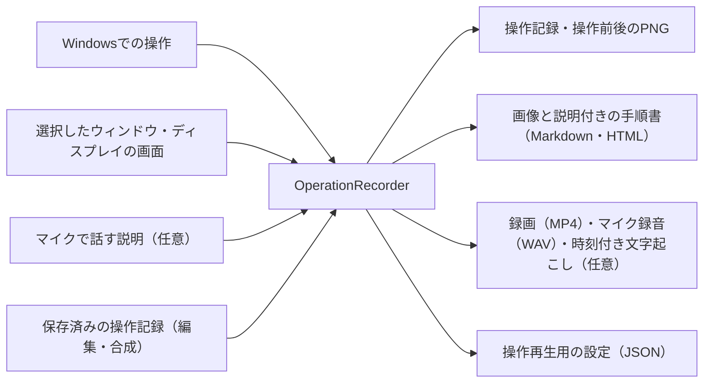
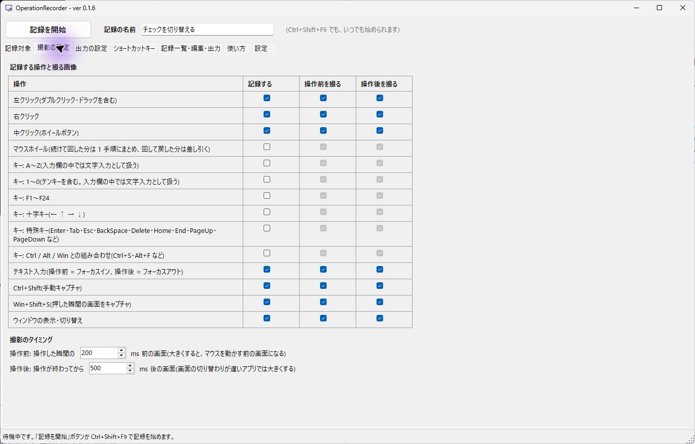
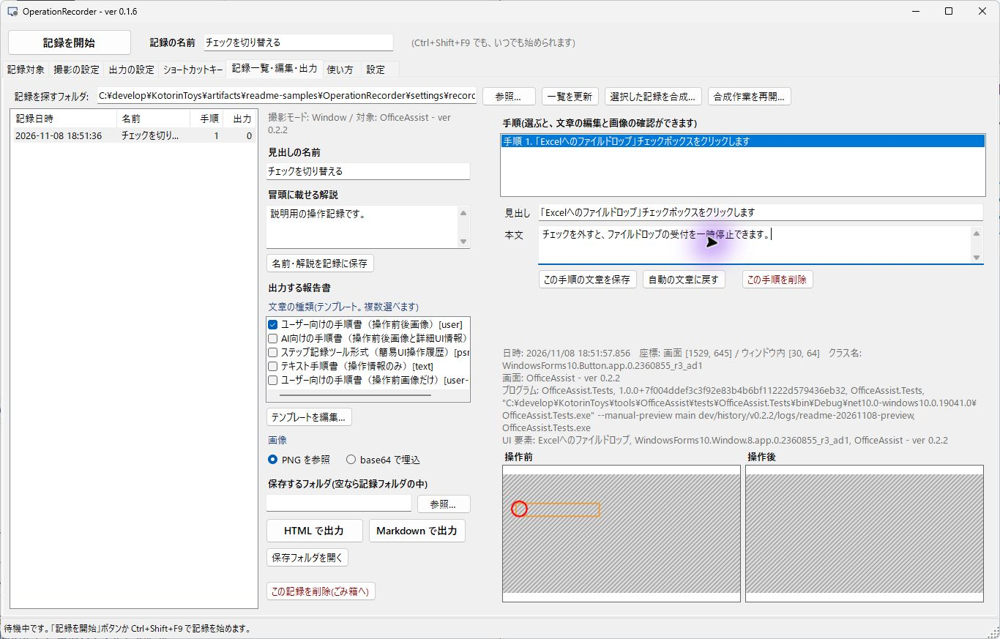

# OperationRecorder

PCの操作と操作前後の画面を記録し、スクリーンショット付きのMarkdown・HTML手順書を作るWindowsアプリです。

[KotorinToys](https://github.com/KotorinChunChun/KotorinToys)のコレクションからインストール・更新・起動できます。単体のインストーラーは[GitHub Releases](https://github.com/KotorinChunChun/OperationRecorder/releases)から入手できます。

## 入力と出力

## できること

- 操作前後の画面をPNGで記録し、クリック位置やドラッグの矢印を付けて手順書を出力する。
- テンプレートで画像の左右・縦並び、操作前だけなどの表示を選ぶ。
- 中断や取り直しで分かれた複数の記録から、重複選択・差し込み・並べ替え・除外をして1本へ合成する。途中保存と再開に対応し、元の記録を残す。
- 記録をconfigへ変換し、対象ウィンドウや画像を監視しながら操作を再生する。
- 名前やクラスが変動する対象について、複数記録からCodex CLIで再生条件の案を作る。

## 使い始める

起動後、「記録する」で対象と保存先を選び、記録を開始します。保存した記録は「記録一覧」で編集・合成・出力できます。操作キーは「ショートカットキー」タブで変更できます。

画面の×はタスクトレイへの格納です。終了するときはトレイメニュー、またはKotorinToysの「停止」を使います。記録中・保存中は停止を拒否するため、先に記録を保存してください。

- [操作記録マニュアル](docs/USERS_GUIDE.md)
- [手順の見出し表記](docs/step-headings.md)
- [ウィンドウの表示・切り替えの記録](docs/window-events.md)
- [KotorinToysとの連携・保存先](docs/kotorintoys-integration.md)
- [リプレイの設定と実行](docs/replay.md)
- [複数記録からの再生条件作成](docs/replay-learning.md)
- [既定の操作キー](config/shortcuts.json)
- [版番号の訂正履歴](docs/version-numbering.md)
- [第三者ソフトウェアの通知](THIRD-PARTY-NOTICES.md)

## 画面で見る操作

以下は0.1.6の画面です。説明用の設定とOfficeAssistのプレビュー画面を使っています。

### 1. 対象を選ぶ

「記録対象」で撮影モードと対象を選び、記録の名前を入力します。例は1つのウィンドウだけを記録するWindowモードです。「記録を開始」を押すと、この画面は隠れます。

### 2. 撮影条件を確認する

「撮影の設定」で、記録する操作と操作前後の画像を選びます。キー入力やデスクトップ全体を記録すると、意図しない情報も残るため、必要な対象だけを選んでください。

### 3. 記録に説明を加える

対象画面を操作し、Ctrl+Shift+F12で保存します。「記録一覧・編集・出力」で記録と手順を選び、本文を補足して「この手順の文章を保存」を押します。

### 4. 手順書を出力する

テンプレートを選び、「HTMLで出力」または「Markdownで出力」を押します。画面下部の出力完了表示を確認し、「保存フォルダを開く」から成果物を確認できます。

画像の斜線は、対象を覆う別ウィンドウなどの写り込みを防いだ領域です。例では操作の記録・文章編集・出力を説明しています。対象の画面内容も残したい場合は、重なったウィンドウを避けて記録し直してください。

### 5. 操作キーを確認する

「ショートカットキー」で開始・取消・取り直し・保存終了のキーを確認できます。変更するときは他アプリと重複しない組合せを選びます。

開発に参加する場合は[開発者ガイド](docs/DEVELOPERS_GUIDE.md)を参照してください。
