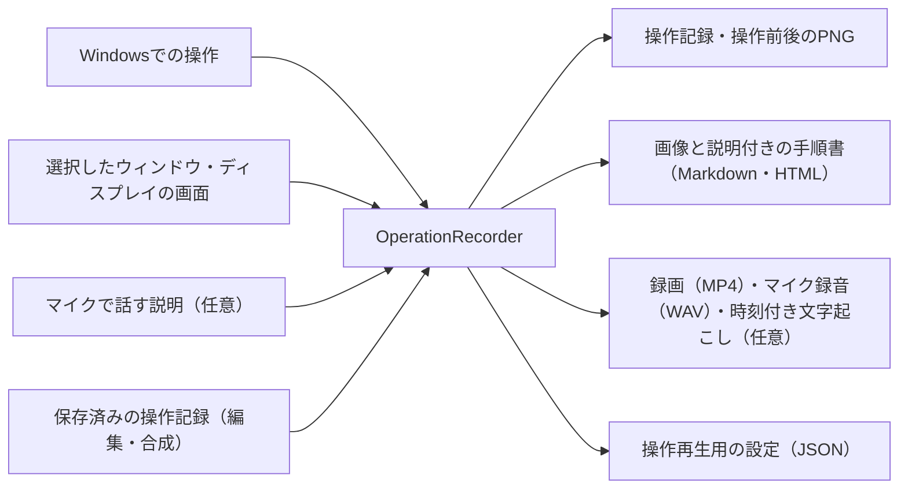

# OperationRecorder

OperationRecorderは、PCの操作風景を記録し、スクリーンショット付きのHTML操作マニュアルを作成するWindowsアプリです。

## 入力と出力

## 成果物はこちら

- [操作前後](https://github.com/KotorinChunChun/OperationRecorder/blob/main/samples/check-capture-settings/user.md)
- [操作前のみ](https://github.com/KotorinChunChun/OperationRecorder/blob/main/samples/check-capture-settings/user-before.md)
- [ステップ記録ツール](https://github.com/KotorinChunChun/OperationRecorder/blob/main/samples/check-capture-settings/psr.md)
- [AI向け](https://github.com/KotorinChunChun/OperationRecorder/blob/main/samples/check-capture-settings/ai.md)

リンク先で手順書をプレビューできます。HTML版は同じフォルダーにあり、画像と一緒にダウンロードして開けます。

[KotorinToys](https://github.com/KotorinChunChun/KotorinToys)のコレクションからインストール・更新・起動できます。単体のインストーラーは[GitHub Releases](https://github.com/KotorinChunChun/OperationRecorder/releases)から入手できます。

画像や動画の撮影、操作の記録に使うツールを選ぶときは、[画面・操作記録ツールの使い分け](https://github.com/KotorinChunChun/KotorinToys/blob/main/docs/recording-tools.md)を参照してください。

## できること

- 操作前後の画面をPNGで記録し、クリック位置やドラッグの矢印を付けて手順書を出力する。
- テンプレートで画像の左右・縦並び、操作前だけなどの表示を選ぶ。
- 中断や取り直しで分かれた複数の記録から、重複選択・差し込み・並べ替え・除外をして1本へ合成する。途中保存と再開に対応し、元の記録を残す。
- 記録をconfigへ変換し、対象ウィンドウや画像を監視しながら操作を再生する。
- 名前やクラスが変動する対象について、複数記録からCodex CLIで再生条件の案を作る。

## 操作手順

- [画面付きの操作手順](docs/operation-steps.md)
- [操作記録マニュアル](docs/USERS_GUIDE.md)
- [手順の見出し表記](docs/step-headings.md)
- [ウィンドウの表示・切り替えの記録](docs/window-events.md)
- [KotorinToysとの連携・保存先](docs/kotorintoys-integration.md)
- [リプレイの設定と実行](docs/replay.md)
- [複数記録からの再生条件作成](docs/replay-learning.md)
- [既定の操作キー](config/shortcuts.json)
- [版番号の訂正履歴](docs/version-numbering.md)
- [第三者ソフトウェアの通知](THIRD-PARTY-NOTICES.md)

開発に参加する場合は[開発者ガイド](docs/DEVELOPERS_GUIDE.md)を参照してください。
