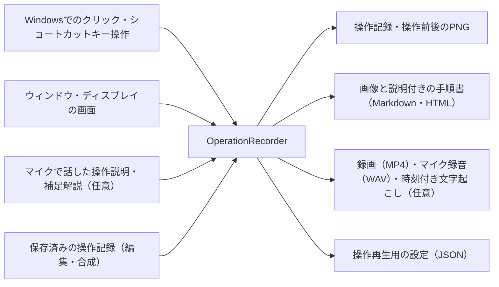

# OperationRecorder

OperationRecorderは、PCの操作風景を記録し、スクリーンショット付きの操作マニュアルを作成するためのWindowsアプリです。

Windowsには元来、ステップ記録ツール（psr）という同様のソフトウェアが内蔵されていましたが、廃止が予定されているため本ツールが置換えになると考えています。

記録完了と同時に即座に他人に配布可能なマニュアルを作成することを目指して開発しました。

## 入力と出力

## 本ツールで作成可能な成果物

本ツールは、テンプレート様式に合わせて自由なフォーマットでの出力に対応しています。

デフォルトで4種類のテンプレートを搭載しています。実際に作成された成果物は以下より確認できます。

- [操作前後の手順書](https://github.com/KotorinChunChun/OperationRecorder/blob/main/samples/check-capture-settings/user.md)
- [操作前のみの手順書](https://github.com/KotorinChunChun/OperationRecorder/blob/main/samples/check-capture-settings/user-before.md)
- [ステップ記録ツール風の手順書](https://github.com/KotorinChunChun/OperationRecorder/blob/main/samples/check-capture-settings/psr.md)
- [AI操作再現向けの詳細記録文書](https://github.com/KotorinChunChun/OperationRecorder/blob/main/samples/check-capture-settings/ai.md)

出力フォーマットにMarkdownとhtmlを選ぶことができ、更にbase64による単独ファイルへの画像埋め込み済みのマニュアル生成にも対応しています。

[KotorinToys](https://github.com/KotorinChunChun/KotorinToys)のコレクションからインストール・更新・起動できます。単体のインストーラーは[GitHub Releases](https://github.com/KotorinChunChun/OperationRecorder/releases)から入手できます。

なお、汎用的なスクリーンショットに特化したツールや、画面録画から動画マニュアルや手順書作成をするためのツールも開発しています。詳しくは [画面・操作記録ツールの使い分け](https://github.com/KotorinChunChun/KotorinToys/blob/main/docs/recording-tools.md)を参照してください。

## 想定用途

1. 人に渡すための手順書の作成（pdf、docx、html）
   画像を埋め込んだファイルにすれば、Teams・Slack・メールなどで簡単に共有できます。
   base64で画像を埋め込んだhtmlなら、htmlしか見れない環境でもアプリ内蔵ブラウザで軽快に閲覧できます。
2. GitHubなどへ公開するための手順書の作成（markdown）
   エンジニアが編集しやすいMarkdown形式の出力に対応しています。
   AIで編集する際も少ないトークンで編集できます。
   Markdownで公開を基本としているGitHubはもちろん、個人ブログ、情報共有サイト、Wiki、CMSへの公開にも活用できます。
3. AIがPCの自動操作を再現するための記録文書の作成（markdown+json）
   パソコンの自動操作（RPA的なこと）をさせるには、クリックしたいUIを教え込む必要がありますが、本ツールを使えばTitle、Class、Captionなど自動操作に必要な内部情報が記録されますので、機械的に再現可能なプログラム生成をAIにさせる際の手助けになります。
   WinアプリやWebブラウザには、だいたいIDが付いているので、それらの情報から操作を再現可能です。
   クリック前後のスクリーンショットも付いているため、毎回IDが変わるようなツールでもAIエージェントで実行すれば操作を再現させることができる可能性が高いです。
   ※難易度が自動操作したい対象によって大きく変わります。完全に再現できることは保証できません。
   本ツールはCLIでの完全操作に対応しており、Skillsを内包しておりますので、CodexやClaudeにSkillとして組み込めば、AIエージェント経由で記録を開始することも可能です。

## できること

- 操作前後の画面をPNGで記録し、クリック位置やドラッグの矢印を付けて手順書を出力する。
- テンプレートで画像の左右・縦並び、操作前だけなどの表示を選ぶ。
- 中断や取り直しで分かれた複数の記録から、重複選択・差し込み・並べ替え・除外をして1本へ合成する。途中保存と再開に対応し、元の記録を残す。
- 記録をconfigへ変換し、対象ウィンドウや画像を監視しながら操作を再生する。
- 名前やクラスが変動する対象について、複数記録からCodex CLIで再生条件の案を作る。

## 操作手順

- [画面付きの操作手順](docs/operation-steps.md)
- [操作記録マニュアル](docs/USERS_GUIDE.md)
- [手順の見出し表記](docs/step-headings.md)
- [ウィンドウの表示・切り替えの記録](docs/window-events.md)
- [KotorinToysとの連携・保存先](docs/kotorintoys-integration.md)
- [リプレイの設定と実行](docs/replay.md)
- [複数記録からの再生条件作成](docs/replay-learning.md)
- [既定の操作キー](config/shortcuts.json)
- [版番号の訂正履歴](docs/version-numbering.md)
- [第三者ソフトウェアの通知](THIRD-PARTY-NOTICES.md)

開発に参加する場合は[開発者ガイド](docs/DEVELOPERS_GUIDE.md)を参照してください。

## 使用言語とライブラリ

- 使用言語はC#（本体）、Python（文字起こし）です。
- .NET 10、Windows Forms、WPF。Markdown処理にはMarkdig、音声入力にはNAudio.WinMMを使います。動画を記録する場合はFFmpegを別途指定します。
- 依存定義と資料 [プロジェクトの依存定義](src/OperationRecorder/OperationRecorderApp.csproj)・[第三者コンポーネント](THIRD-PARTY-NOTICES.md)

## ライセンス

OperationRecorderの独自コードと文書には[MITライセンス](LICENSE)が適用されます。依存ライブラリーの条件は[第三者コンポーネント](THIRD-PARTY-NOTICES.md)を参照してください。
