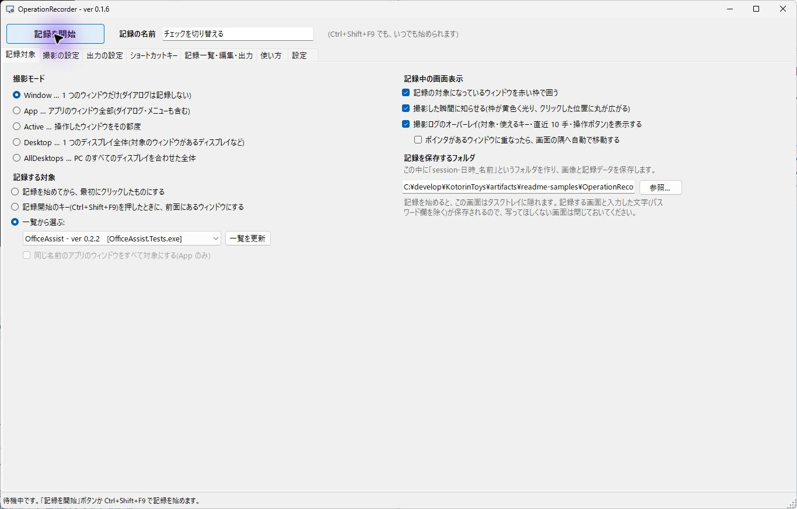
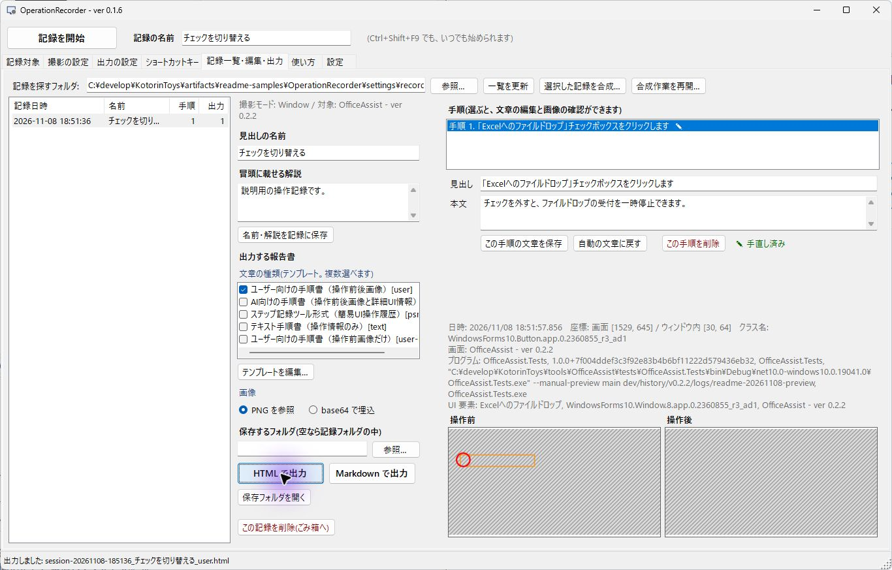
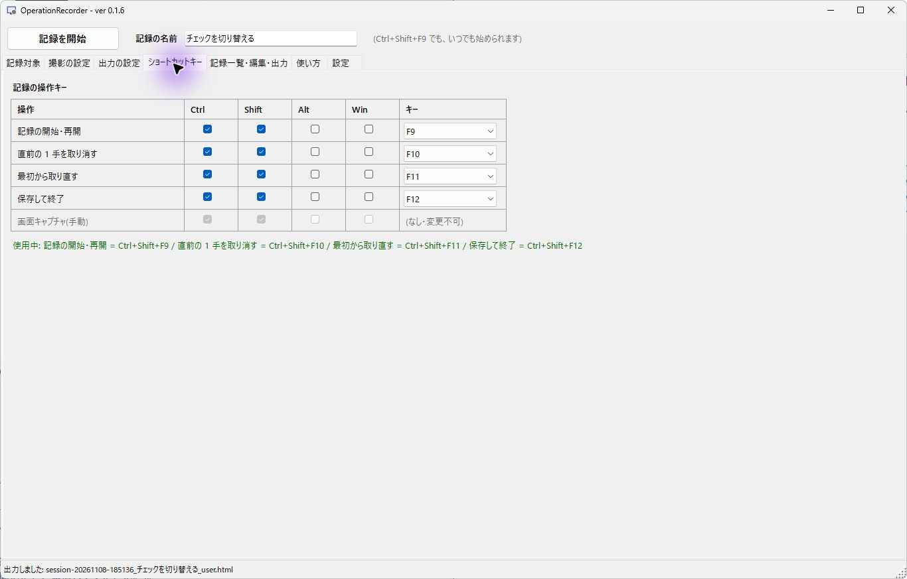

# OperationRecorder

[製品版の番号と訂正履歴](docs/version-numbering.md)

PC の操作を記録して、スクリーンショット付きの操作手順書(md)を作るデスクトップアプリ。
KotorinToysのコレクションからインストール・起動・表示・停止ができる。配布物はGitHub Releasesから入手できる。
記録をconfigへ変換し、条件を監視しながら操作を再現する[リプレイ](docs/replay.md)も利用できる。
対象の名前やクラスが変わる場合は、[複数記録からCodex CLIで条件を作成](docs/replay-learning.md)できる。

- KotorinToysからの起動と管理: [連携ガイド](docs/kotorintoys-integration.md)
- 使い方(利用者向け): [操作記録マニュアル](docs/USERS_GUIDE.md)
- [サンプル手順書：撮影設定と操作キーの確認](samples/check-capture-settings/README.md)
- 開発用のショートカット一覧: [config/shortcuts.json](config/shortcuts.json)（既定値。実際のキーはアプリ内で変更可能）
- 本体対応インストーラーの入手: [GitHub Releases](https://github.com/KotorinChunChun/OperationRecorder/releases)。KotorinToysからは公開カタログを更新し、「インストール」を選ぶ。
- 配布に含む第三者ソフトウェア: [配布通知](THIRD-PARTY-NOTICES.md)
- インストーラー作成・公開の手順: [リリース手順](docs/release.md)
- 全機能のコマンドライン試験とケース一覧: [自動テスト](docs/testing.md)

## 動画ではなく静止画で記録する理由

画面を動画で残して後から必要な場面を切り出す方法は、撮影のタイミングを後で調整できるため実用的に思える。
OperationRecorderは、次の理由から操作した瞬間の前後だけを静止画(PNG)で記録する。

- **自由な解像度の変化に対応できる。** 動画は記録を始めたときの範囲・解像度に縛られる。静止画は 1 枚ずつ、
  その時点の対象の範囲と解像度で撮るので、途中でウィンドウの大きさ・ディスプレイの拡大率・ディスプレイの構成が
  変わっても、そのまま残せる。
- **容量や処理コストが軽い。** 残すのは操作の前後の画面だけで、何も操作していない間の記録は要らない
  (直近 1.5 秒ぶんの画面をメモリに持つだけで、操作が無ければ捨てる)。長い作業を記録しても、ファイルの量は
  手順の数に比例するだけで、動画のエンコード・デコードの重い処理も要らない。
- **画質が劣化しない。** 可逆圧縮の PNG で保存するので、文字の細部まで撮ったときの完璧な状態の画像が残る。
  動画の非可逆圧縮のような、文字のにじみやブロックノイズが無い。

静止画で記録するときも、撮影のタイミングや出力する内容を調整できる。

| 後から変えたいこと | 対応 |
|---|---|
| 操作の何 ms 前・何 ms 後の画面にするか | 「撮影の設定」タブで決める(直近の画面をメモリに持っているので、操作より前の画面も撮れる) |
| マウスポインタ・クリック位置の丸・ドラッグの矢印・部品の枠 | 画像には描かずに保存し、出力するときに操作ログ(座標・部品の位置)から合成する。何度でも描き方を変えて出力し直せる |
| 中断・取り直しで記録が分かれた | 複数の記録から手順を選び、重複選択・差し込み・並べ替え・除外をして合成する。作業を途中保存し、元の記録を残した新しい記録に仕上げる |
| 手順の文章・要らない手順 | 記録一覧で直す・消す(記録そのものは書き換えず、出力するときに反映する) |

## 画面で見る操作

以下は0.1.6の画面です。説明用の設定とOfficeAssistのプレビュー画面を使っています。

### 1. 対象を選ぶ

「記録対象」で撮影モードと対象を選び、記録の名前を入力します。画面の例では、1つのウィンドウだけを記録するWindowモードを選んでいます。「記録を開始」を押すと、この画面は隠れます。

### 2. 撮影条件を確認する

「撮影の設定」で、記録する操作と操作前後の画像を選びます。キー入力やデスクトップ全体を記録すると、意図しない情報も残るため、必要な対象だけを選んでください。

### 3. 記録に説明を加える

対象画面を操作し、Ctrl+Shift+F12で保存します。「記録一覧・編集・出力」で記録と手順を選び、本文を補足して「この手順の文章を保存」を押します。

### 4. 手順書を出力する

テンプレートを選び、「HTMLで出力」または「Markdownで出力」を押します。画面下部の出力完了表示を確認し、「保存フォルダを開く」から成果物を確認できます。

画像の斜線は、対象を覆う別ウィンドウなどの写り込みを防いだ領域です。例では操作の記録・文章編集・出力を説明しています。対象の画面内容も残したい場合は、重なったウィンドウを避けて記録し直してください。

### 5. 操作キーを確認する

「ショートカットキー」で開始・取消・取り直し・保存終了のキーを確認できます。変更するときは他アプリと重複しない組合せを選びます。

開発に参加する場合は[開発者ガイド](docs/DEVELOPERS_GUIDE.md)を参照してください。
