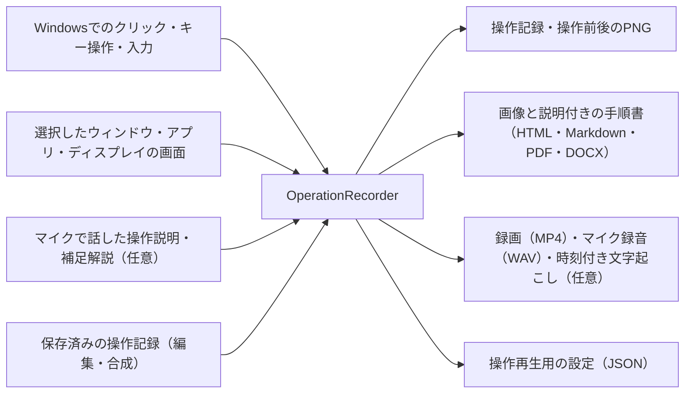

# OperationRecorder

OperationRecorderは、PCの操作風景を記録し、スクリーンショット付きの操作マニュアルを作成するためのWindowsアプリです。

Windowsのステップ記録ツール（PSR）は廃止が予定されています。OperationRecorderは、その代わりに操作を記録し、記録を保存したときに共有用の手順書を出力できるように開発しました。

## 入力と出力

## 本ツールで作成可能な成果物

標準テンプレートは、操作前後、操作前のみ、ステップ記録ツール風、AI向け、画像なしのテキストの5種類です。テンプレートを編集して、載せる情報や画像の並べ方を変えられます。

実際に出力した4種類のサンプルを確認できます。

- [操作前後の手順書](https://github.com/KotorinChunChun/OperationRecorder/blob/main/samples/check-capture-settings/user.md)
- [操作前のみの手順書](https://github.com/KotorinChunChun/OperationRecorder/blob/main/samples/check-capture-settings/user-before.md)
- [ステップ記録ツール風の手順書](https://github.com/KotorinChunChun/OperationRecorder/blob/main/samples/check-capture-settings/psr.md)
- [AI操作再現向けの詳細記録文書](https://github.com/KotorinChunChun/OperationRecorder/blob/main/samples/check-capture-settings/ai.md)

出力形式はHTML・Markdown・PDF・DOCXです。HTMLとMarkdownは、PNGへの参照とBase64での画像埋め込みを選べます。PDFとDOCXは画像をファイルに埋め込みます。PDFの作成にはMicrosoft Edge、DOCXの作成にはPandocを使います。 [出力の設定](docs/USERS_GUIDE.md#pdfdocxで出力する)

[KotorinToys](https://github.com/KotorinChunChun/KotorinToys)のコレクションからインストール・更新・起動できます。単体のインストーラーは[GitHub Releases](https://github.com/KotorinChunChun/OperationRecorder/releases)から入手できます。

なお、汎用的なスクリーンショットに特化したツールや、画面録画から動画マニュアルや手順書作成をするためのツールも開発しています。詳しくは [画面・操作記録ツールの使い分け](https://github.com/KotorinChunChun/KotorinToys/blob/main/docs/recording-tools.md)を参照してください。

## 想定用途

1. 人に渡すための手順書の作成（PDF・DOCX・HTML）
   画像を埋め込んだファイルにすれば、Teams・Slack・メールなどで簡単に共有できます。
   画像を埋め込んだHTMLはファイル1つで共有でき、ブラウザーで開けます。
2. GitHubなどへ公開するための手順書の作成（Markdown）
   エンジニアが編集しやすいMarkdown形式の出力に対応しています。
   Markdownで公開を基本としているGitHubはもちろん、個人ブログ、情報共有サイト、Wiki、CMSへの公開にも活用できます。
3. 自動操作を再現するための資料の作成（Markdown・JSON）
   ウィンドウのタイトルやクラス名、取得できたUI要素の名前・AutomationId、座標、操作前後の画像を記録します。AI向けテンプレートは、これらの情報を再現手順を作るための資料にまとめます。
   要素IDや画面名が変わる対象では、複数回の記録を比較して、Codex CLIで正規表現や条件式の案を作れます。再生に使う条件は利用者が確認します。
   記録の開始にはPowerShellの記録スクリプト、保存済みの手順書の出力と操作の再生にはCLIを使えます。 [PowerShellでの記録方法](docs/USERS_GUIDE.md#付録-コマンドで使うpowershell-7)

## できること

- 1つのウィンドウ、アプリ全体、操作中のウィンドウ、1つのディスプレイ、全ディスプレイから撮影範囲を選ぶ。対象範囲内でウィンドウが新しく表示されたときや切り替わったときも記録する。
- 操作前後の画面をPNGで保存し、クリック位置やドラッグの矢印を付けた手順書を出力する。録画とマイク録音を有効にするとMP4とWAVを保存でき、マイクの説明は文字起こしして、時刻に対応する手順の本文へ自動で追記できる。
- 文字起こしは任意。録音中に認識結果を表示し、保存後に手順ごとの本文を別モデルで再生成できる。ローカルのWhisper・Haasはボタンで導入や削除ができる。[文字起こし方式の設定](docs/USERS_GUIDE.md#文字起こし方式の設定)
- 保存した記録の見出しや本文を書き換え、不要な手順を削除して再出力する。
- 中断や取り直しで分かれた複数の記録から、重複選択・差し込み・並べ替え・除外をして1本へ合成する。途中保存と再開に対応し、元の記録を残す。
- 記録をリプレイ用のJSONに変換し、手動・指定日時・ホットキー・対象ウィンドウの出現などを開始条件にして再生する。再生中はウィンドウ・UI要素・画像が条件に合うまで待ち、待機上限に達すると理由を表示して停止する。

## 操作手順

- [画面付きの操作手順](docs/operation-steps.md)
- [操作記録マニュアル](docs/USERS_GUIDE.md)
- [手順の見出し表記](docs/step-headings.md)
- [ウィンドウの表示・切り替えの記録](docs/window-events.md)
- [KotorinToysとの連携・保存先](docs/kotorintoys-integration.md)
- [リプレイの設定と実行](docs/replay.md)
- [複数記録からの再生条件作成](docs/replay-learning.md)
- [既定の操作キー](config/shortcuts.json)
- [版番号の訂正履歴](docs/version-numbering.md)
- [第三者ソフトウェアの通知](THIRD-PARTY-NOTICES.md)

開発に参加する場合は[開発者ガイド](docs/DEVELOPERS_GUIDE.md)を参照してください。

Codex・Claude Codeから操作記録や手順書の再出力を行う場合は、[AIスキルの導入](docs/ai-skill.md)を参照してください。別のPCにも導入できるリポジトリ参照方式のスキルを同梱しています。

## 使用言語とライブラリ

- 使用言語はC#（本体）、Python（ローカル文字起こし）です。
- .NET 10、Windows Forms、WPF。Markdown処理にはMarkdig、音声入力にはNAudio.WinMMを使います。動画を記録する場合はFFmpegを別途指定します。
- 依存定義と資料 [プロジェクトの依存定義](src/OperationRecorder/OperationRecorderApp.csproj)・[第三者コンポーネント](THIRD-PARTY-NOTICES.md)

## ライセンス

OperationRecorderの独自コードと文書には[MITライセンス](LICENSE)が適用されます。依存ライブラリーの条件は[第三者コンポーネント](THIRD-PARTY-NOTICES.md)を参照してください。
