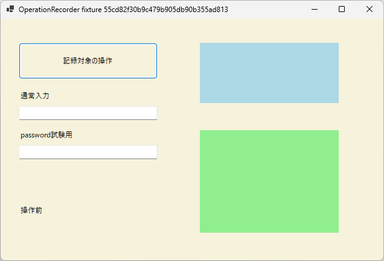
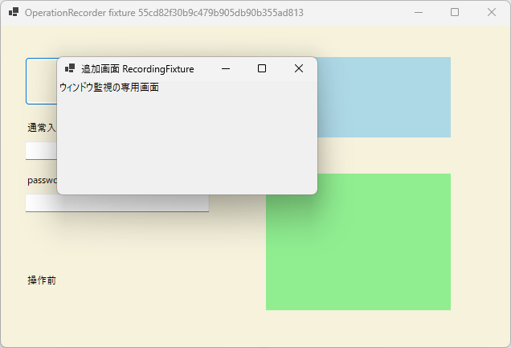

# OperationRecorder 0.1.10 実装計画・報告

外部証拠の開発結果に対応する[試験一覧](test-cases-evidence-development.json)と、GitHub配布版に対応する[試験一覧](test-cases.json)をそれぞれ参照。下部にGitHub配布時の記録を掲載する。

## 設計

外部ツールは既存の非表示brokerへschema 2で接続し、`StartSession`で対象を固定してから `CaptureSnapshot` を送る。画像は既存のWGC workerと公開条件で保護する。window graphだけが必要な場合は `ListWindows` を使う。単発取得は操作許可や工程状態を作らず、通常記録から独立した出力の `snapshots/<requestId>/` に保護PNGとUI構造を保存する。`snapshot-saved` と `snapshot-inadequate` を品質で区別し、同一要求の再実行を拒否する。

単発取得はユーザーとWindowsセッション単位で同時に1件を扱う。使用中は `snapshot-busy` を返し、待ち行列は作らない。通常の記録ループ・フックに取得要求を渡さない。取得応答の期限、画素の鮮度、対象識別、保存検証、公開条件は既存経路と共通にする。操作用EXEは追加しない。

## 進め方と検証

- [x] P1：schema 2の単発取得、PowerShell入口、期限・競合・既存工程との分離を実装し検証する。
- [x] P2：専用WinForms fixtureで子と所有窓の生成、OS標準の確認ダイアログ、ダミーパスワードUIを操作し、通常記録との並行動作と成果物を検証する。Core回帰を実施しコミットする。
- [x] 仕様と結果を指定チャットに共有し、利用側での対応を依頼する。

## P1の検証

v0.1.9からv0.1.10へ更新。受付には既存の接続・取扱いを使い、同じWindowsセッション内の同一SIDで名前付きmutexを使う。取得workerのキャンセル処理を待ってから枠を解放する。PowerShell 7.6の `Get-OperationEvidenceSnapshot` は既存のschema 2セッションを受け取る。

Coreは570件成功、失敗・スキップ0、ビルド警告0（`logs/core-20261118/summary.json`）。追加7件は保存先とSHA、操作工程との分離、対象の固定、重複拒否、公開不足と鮮度不足での黒化、競合と期限後の復帰を確認した。単発取得の占有中に別セッションの前後取得が通ることも確認した。

## P2の検証

実際のRecorderと専用WinFormsを起動し、別のPowerShellプロセスから実製品の単発取得を呼んだ。子HWNDと所有フォームを生成し、ダミーパスワードを入力・消去した。標準MessageBoxの `#32770` と対象PID・所有者・OKボタンを検証し、UI AutomationでOKを押した。外部要求の直前・直後に通常記録を確認し、取得要求による工程増分なし、追加の所有フォーム生成後も同一PIDの通常ログが1件から3件に増えた。通常側の検証対象はウィンドウ操作ログであり、通常側の画像は保存しなかった。

別PowerShellでは事前に期限切れの要求も送り、拒否と成果物なしを確認した。処理中の期限超過・次要求の復帰はCoreで模擬workerを用いて確認した。ネイティブ試験の保存出力はPNG全画素が黒で、PNG/UI/groupのSHAが一致し、パスワード欄の識別は残るがダミー値は残らなかった。所有窓とダイアログの実WGC画像・UI構造は保存された。鮮度の条件を満たさないフレームは、表示状態にかかわらず `stale-frame` として公開を拒否した。独立実行ではroot・所有窓がfresh、統合実行では所有窓がfreshだった。ダイアログのフレームはどちらの実行でも鮮度不足だったため、公開成功とは扱わない。

| 試験 | 結果 | 記録 |
|---|---|---|
| Core | 570成功、旧563件の欠落なし | `logs/core-20261118/summary.json` |
| Snapshot | 1成功、独立実行と公式入口で再現 | `logs/snapshot-accepted-20261118/summary.json` |
| WindowEvents | 28成功 | `logs/window-events-20261118/summary.json` |
| Wgc | 9成功 | `logs/wgc-20261118/summary.json` |

すべて失敗・スキップ0。app・tests・2 fixtureのビルドは警告・エラー0。試験一覧は397メソッド・633ケース。実業務アプリ、本物の資格情報、OSの保護デスクトップは試験対象外とした。

## 検証時に保存した画像

**通常記録の前後画像。** `WindowEvents` のアプリ全体モードで、専用WinFormsアプリが所有フォームを開いた工程を撮影した。左はメインフォームのみ、右は「追加画面」が開いた状態。パスワード欄は空の状態で撮影している。元ファイルは `logs/window-events-20261118/recording/` 配下の `img/0001_before.png` と `img/0001_after.png`。

| 所有フォームを開く前 | 開いた後 |
|---|---|
|  |  |

**別ツールからの単発取得。** `Snapshot` 試験で、通常記録を続けながら専用フォームの各ウィンドウをWGCで取得した。下の画像は検証時に保存した保護済みPNGそのもの。`fresh` の所有フォームも、公開プロファイルを指定していないため黒く保護された。パスワード欄を含むフォームと標準MessageBoxは `stale-frame` と判定された。元ファイルは `logs/snapshot-accepted-20261118/recording/` 配下の各単発取得に含まれる。掲載画像はすべて元ファイルとのSHA256一致を確認した。

| パスワード欄を含むメインフォーム | 所有フォーム | OS標準MessageBox |
|---|---|---|
|  |  |  |
| 636 × 433 px、鮮度不足 | 326 × 173 px、鮮度条件を満たし公開プロファイルなし | 220 × 152 px、鮮度不足 |

## 利用側への共有

実装 `1cb95eb` と専用フォーム試験 `6bea6e9` を完了後、指定のCodexチャット「クロノス自動操作」へ仕様、既存の操作前後APIとの使い分け、検証結果、鮮度不足時の扱いを共有した。利用側コードの接続更新と隔離された専用フォームでの結合試験を依頼した。

## GitHub配布版 OperationRecorder v0.1.10 公開準備

- [x] v0.1.8およびv0.1.9の同梱製品定義に残った開発状態を更新ヘルパーが拒否する条件を特定した。新規配布の定義を公開状態に変更し、保守処理では対象製品の該当2版だけを互換扱いにする。
- [x] Releaseビルドは警告・エラー0件、Core 515件合格。録画・再生処理、GUIはv0.1.8のDesktop 59件、WindowEvents 28件と配布候補の隔離画面確認を採用した。
- [x] 本体の事前照合で、v0.1.10の配布台帳と展開済み製品定義、旧v0.1.8／v0.1.9の定義を確認した。互換対象外v0.1.7相当の開発用定義を拒否した。採用ソース257ファイルと配布入力513ファイルの機密検出は0件。インストーラーを非実行で展開し全513ファイルと更新用ファイルを照合した。
- [x] このPCの正式導入を、旧番号1.6.0から更新済みのv0.1.8からv0.1.10へ上書きした。設定・記録の保持、非表示の再起動、管理応答 `ready=true`、導入後の513ファイルの一致を確認した。v0.1.9からの互換は製品定義の試験で確認した。
- [x] [v0.1.10を公開](https://github.com/KotorinChunChun/OperationRecorder/releases/tag/v0.1.10)した。配布ソースは子`4bc4bfe`、親`08233b6`。公開物97,778,368バイト、SHA-256 `4919add52ae1a076cddf5b740d591a37bd8f5a48fb602b15187671b32e910781`、署名発行元 `CN=KotorinChunChun` をこのPCで確認した。
- [x] [本体の公開一覧を更新](https://github.com/KotorinChunChun/KotorinToys/actions/runs/44354705840)し、実際の本体取得処理で匿名ダウンロードと容量・SHA-256の照合を確認した。現行本体のInno用台帳は `unsigned-public-build` を要求するため、本体は「未署名」と表示する。公開setupの署名はダウンロード後に別途検証し `Valid` だった。
