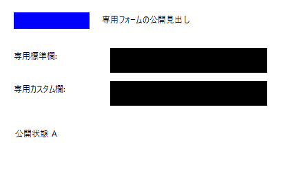
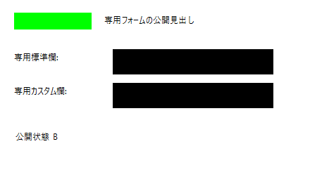

# OperationRecorder 0.1.12 実装計画・報告

## 設計

schema 2の `groupPolicy.passwordProfile` を指定した場合だけパスワードマスク方式を選ぶ。EXEと同じ管理下の `password-evidence-catalog.json` に登録したID・版・SHA256で資材を固定する。資材のEXEパス種別・SHA256・ファイル版を照合する。マスク外の画素を保存するため、この版の対象は登録したパスワード欄が存在する、可視のrootウィンドウ1枚に限定する。可視の別トップレベルや未知HWNDがあれば拒否する。従来方式とは併用しない。

パスワード欄は事前審査した公開ラベル、Native HWNDとクラス、子関係、UIAの型・物理矩形、Win32矩形、DPI・フレーム寸法、非文字構造で絞る。`IsPassword` は補助検査とし、登録欄は属性がfalseでもマスクする。不明なパスワード要素、登録と実測の不一致、はみ出しや挙動を確定できない画面は全黒。安全な余白を含む登録マスクは実測欄を完全に覆う。画面全体の移動は要求間で位置を再観測し、取得中の移動は拒否する。

WGCの前後で同じ欄のHWND・相対位置・世代・構造を確認する。不透明な黒で作った新しい画像のマスク外だけに元画素を描画し、マスクされていないフレームは書き出さない。brokerは保存画像・SHA、登録マスクの全画素、構造、live HWNDの関係とWin32矩形を照合する。取得・確認が不十分なら通常のACKを返さない。録画の合間にアプリが独自描画する秘密のないことは、登録版・画面の審査と隔離試験で確認する前提。観測で区別できない状態を受入済みとは扱わない。

## フェーズ

- [x] P1：登録、パスワード欄の観測、マスクと保存検証、schema 2との接続を実装してCoreを確認する。
- [x] P2：専用WinFormsで実WGCとPowerShellの前後ACK、標準/カスタム欄、移動と拒否条件を確認し報告する。

## P1の結果

クロノス側の `Get-LoginFields` と `AssertFieldTarget` は、同じPIDの子関係、Nativeクラス、公開STATICラベルとの隣接、矩形を使っていた。取得側もこれらを照合し、登録DPI・相対矩形・非文字UI構造・rootの識別と合わせた。ラベル文字の取り扱いは登録された公開ラベル候補だけで、パスワード欄の名前や値は取得しない。

パスワードモードだけ、検証前の出力を応答対象外の一時フォルダーに置く。workerの出力は最初からマスク済みで、brokerのPNG・SHAと現在のWin32照合を通った後に所定の工程フォルダーに確定する。応答直前にも対象と鮮度を再確認する。ROI方式で導入した32 ms以内の時計再確認を新方式にも使い、元のフレーム時刻と取得期限を維持した。

Core 626件成功、失敗・スキップ0、Releaseビルド警告・エラー0。追加15件では、登録資材の改変と不足、EXEのパス・版・SHA不一致、マスクの余白・重複・範囲外、標準属性とカスタム欄、非マスク画素の保持、全黒やマスク1画素改変・透過の不合格を確認した。記録は `logs/core-20261119/summary.json`。

## P2の結果

専用WinFormsと別プロセスのPowerShellで、承認資材の事前検査、capability、実broker・worker・WGCを経由した前後のACKを確認した。標準Editは `IsPassword=true`、自描画の別HWNDを持つ欄は `IsPassword=false` と実測した。どちらも登録した隣接ラベルとWin32・UIAの矩形で照合し、マスク内は全画素が不透明な黒、マスク外は公開見出しと表示色が残った。保存PNG・構造・SHAの一致と、テスト用表示値が画像外の出力に残らないことを検査した。

`before-saved` と操作許可の後に専用フォームの操作を1回だけ行い、ウィンドウを画面上 `(48,48)` から `(66,60)` へ移動した。相対矩形とDPI 96を再確認し、同じ工程トークンで `after-saved` を得た。登録DPIを120とした不一致、カスタム欄の幅拡大で登録マスクの外にはみ出す状態、未知の可視の子ウィンドウは、いずれも `password-layout-unproven`、全黒、`before-inadequate`、操作0回だった。

| 操作前。標準欄・カスタム欄を保護 | 操作後。移動後も相対位置で保護 |
|---|---|
|  |  |

幅変更の拒否時に保存した全黒の代替PNG。掲載した3枚は、最終試験で保存されたPNGをSHA256照合して添付した。

| 試験 | 結果 | 記録 |
|---|---|---|
| Core | 626成功。前版611件の欠落なし | `logs/core-20261119/summary.json` |
| PasswordEvidence | 1成功。別PowerShell・実WGC・標準/カスタム・前後ACK・移動と3種の拒否 | `logs/password-final-20261119/summary.json` |
| ApprovedRoi | 1成功 | `logs/roi-regression-20261119/summary.json` |
| Wgc | 9成功 | `logs/wgc-regression-20261119/summary.json` |
| Snapshot | 1成功 | `logs/snapshot-regression-20261119/summary.json` |

全試験で失敗・スキップ0。4プロジェクトのReleaseビルドで警告・エラー0。ケース表は426メソッド・691ケース。実機試験の範囲は専用フォームと登録DPIの不一致までで、実クロノスと実C1欄、業務用の登録資材、複数モニターをまたぐ移動や撮影中の一瞬の画面変化は受入していない。

## APIと検証用成果物

[パスワード欄を保護する方式の契約](../../../docs/password-only-local-evidence.md)に、登録資材、`Test-OperationEvidencePasswordProfile`、`groupPolicy.passwordProfile`、`password-only-local-evidence` の扱いを記載した。リポジトリのルートから `pwsh -NoProfile -File ./dev/scripts/Test-OperationRecorder.ps1 -Suite PasswordEvidence` で専用フォーム試験を再現できる。

検証用ビルドは `artifacts/password-evidence-v0.1.12/` に保持する。専用試験で実際に使った次のファイルとのSHA256一致を確認した。同フォルダーの `verified-files.json` にも記録する。業務用の登録資材は含めない。

| ファイル | 試験で使用したSHA256 |
|---|---|
| `OperationRecorder.exe` | `0fb05897ae0fdd3aa9a3c9d317f4ec549745489af64b15e73decb93b1d05b95d` |
| `OperationRecorder.dll` | `67b3631cc8ed139f2924fc5921a5bf3e3d70be140793bfdeed4730a72f8fb7ee` |
| `scripts/OperationRecorderEvidence.psm1` | `97fa72900b9eef567e515de0d2d269dc5815bbca27b75850713b48d59f0da15c` |

専用フォームの登録例は `logs/password-final-20261119/recording/oprec-password-e40218f7ff3142eb82b5f2d8a423656c/program/`。同じ試験フォルダーの `result.json` に判定、各保存PNGのSHA、操作回数、バイナリ照合のためのSHAを残した。
