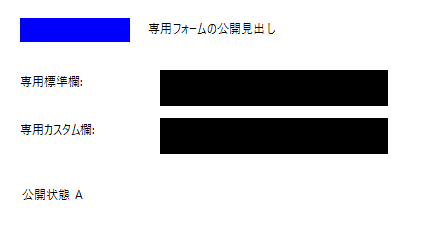

# OperationRecorder 0.1.13 実装計画・報告

## 設計

ログイン前は既存の登録済みパスワード保護を使う。StartSessionに登録済み `transitionAfterRoiProfile`、対象工程のBeginStepに `expectWindowTransition:true` を指定する。EndStepでは元と同じPID・開始時刻・Windowsセッション・EXEとSHAのプロセス内で、元のログイン窓が消えた後の唯一の未所有の候補をbrokerが選ぶ。切替先のHWNDはbrokerが決める。切替先のWGC証拠は既存の固定領域照合で証明し、成功した場合だけ同じstepId/tokenのafterを確定する。切替先が直接所有する同プロセスの可視の通知窓が1枚ある場合は、別の `owned / after` シーンも必須照合に含める。未知の窓や曖昧な候補・取得不足は保留で終了し、工程の再実行を許さない。元のセッションと撮影結果は保持し、切替先で続けて作業する場合は新しいセッションで対象を再確認する。

設定候補は読み取り専用の独立プロセスで、対象PID/開始時刻/EXE/Windowsセッション/HWNDとNative/UIAの範囲を照合する。DPI、キャプチャ枠、UI構造ハッシュ、審査対象の公開ラベルと一意の欄の構造だけを返す。WGC、画素、入力、欄の名前・値、保存先・資材の書き込みは行わない。対象範囲は既存のパスワード保護の適用対象と合わせ、正規パスの対象アプリと専用fixtureとする。

## フェーズ

- [x] P1：切替の同一工程保存、設定候補CLI、PowerShell契約を実装し、Core回帰を確認する。
- [x] P2：専用WinFormsの別HWND遷移、停止ケース、読み取り専用の設定候補を実際に確認し、仕様・成果物を記録する。

## P1の結果

到着した最初の有効な `EndStep` でトークンを消費する。期限切れや呼び出し元の中断後も再撮影を拒否する。取得した後続画面は固定領域以外を黒く処理し、検証中の出力は通常の確定先から外す。最終のウィンドウ構造、EXEのSHA、フレーム鮮度と期限を確認してから `completed` を保存する。後から `InspectSession` で前後の画像と工程を改めて検証できる。

設定候補のコマンドは、独立プロセスでWin32とUI Automationの構造を再確認して `candidate-only` を返す。候補に画素、入力量、パスワード文字列、UIの動的な名前は含まれない。子プロセスは期限付きで、Job Objectで終了を管理する。

Coreは643件合格。0.1.12の626件に欠落がなく、追加17件で選択先の別PID・複数候補・所有関係、期限切れと取消後の再送、設定候補の対象・引数などを確認した。Releaseビルドの警告・エラーは0。PowerShellの4変更ファイルは構文チェックを通過した。試験記録は `logs/core-final-20261119/summary.json`。

## P2の結果

別プロセスのPowerShellから専用WinFormsを対象に、実broker・worker・WGCを通した。すべてのケースでフォームの操作は1回。事前の保存と操作許可を受けた後に操作し、成功ケースでは `BeginStep` と `EndStep` の工程ID・トークンが一致した。保存後に `InspectSession` で再検査した。

| ケース | 最初のEndStep | 保存後の再検査 |
|---|---|---|
| ログイン窓を非表示にし、既知の別HWNDを表示 | `after-saved` | `completed` |
| 既知の別HWNDとその直下の既知の所有通知 | `after-saved`。rootと通知の個別画像を保存 | `completed` |
| ログイン窓の旧HWNDを実際に破棄 | `after-saved`。旧HWNDの消失を確認 | `completed` |
| 後続rootの承認済み識別画素が不一致 | `transition-unconfirmed` | `indeterminate` |
| 所有通知の承認済み識別画素が不一致 | `transition-unconfirmed` | `indeterminate` |
| 同一プロセスの後続root候補が2枚 | `transition-unconfirmed` | `indeterminate` |
| after保存先を別データで占有 | `output-exists`。先に置いたマーカーを保持 | `indeterminate` |
| 初回EndStepの期限切れ | `deadline-exceeded` | `indeterminate` |

未確定の5ケースでは after を確定せず、同じトークンによる再撮影と次の操作を拒否した。成功の3ケースでは同じトークンの再送を `duplicate-step` で拒否した。別PIDの拒否と呼び出し取消後の再送禁止はCoreでも確認した。

通知が開くと、rootのUI構造にも所有窓の範囲が入った。専用フォームでは通知あり・なしのrootシーンを個別に用意した。旧HWNDを破棄した際は、事前承認済みの非表示IME補助窓の所有先が変わった。同一PID・HWND・世代を保ち、元rootから後続rootへ直接移った非表示の補助窓に限って構造を引き継いだ。その窓は撮影対象から外した。

96 DPIの専用フォームで標準パスワード欄と属性なしのカスタム欄の候補を取得し、Win32/UIAの座標、型、事前に算出したUI構造ハッシュと一致した。未登録の公開ラベルと別Windowsセッションは拒否した。候補取得によるファイルの追加はなかった。

### 実際に保存したWGC画像

下の3枚は、最終試験で保存されたPNGをSHA256照合して掲載した。操作前は両方のパスワード欄とその周囲を黒くし、見出しと公開ラベルは残った。操作後のrootと所有通知では、照合済みの公開領域だけが残った。

| 操作前のログイン窓 | 切替後のroot | 切替後の所有通知 |
|---|---|---|
|  |  |  |

### 回帰試験

| 試験 | 結果 | 記録 |
|---|---|---|
| Core | 643件合格 | `logs/core-release-20261119/summary.json` |
| WindowTransition | 専用WinFormsの1テスト、切替8ケースと設定候補4ケース合格 | `logs/window-transition-final-20261119/summary.json` |
| Snapshot | 1件合格。親子・所有窓、標準MessageBoxの取得とOK、通常記録の継続 | `logs/regression-Snapshot-20261119/summary.json` |
| PasswordEvidence | 1件合格。標準欄・カスタム欄の保護 | `logs/regression-PasswordEvidence-20261119/summary.json` |
| ApprovedRoi | 1件合格 | `logs/regression-ApprovedRoi-20261119/summary.json` |
| Wgc | 9件合格 | `logs/regression-Wgc-20261119/summary.json` |

最終試験の失敗・スキップは0。4プロジェクトのReleaseビルドの警告・エラーは0。ケース表は438メソッド・709ケース。Snapshotの初回と再試験は専用システムダイアログのUI Automationの `Invoke` で失敗した。試験側で同じPID、所有元、ウィンドウクラスとIDOKボタンを再確認してから、専用ダイアログにIDOKを送る経路を追加した。最終試験ではその経路で `DialogResult.OK` と記録の継続を確認した。単発取得の任意の所有窓は `stale-frame`、必須のrootとシステムダイアログは `fresh` だった。

## 呼び出しと検証用ビルド

[切替APIと読み取り専用コマンド](../../../docs/approved-window-transition.md)に呼び出し例を記載した。検証用のframework-dependentビルドは `artifacts/window-transition-v0.1.13/`。ファイル版は `0.1.13.0`。ProductVersionのコミット部分はビルド時点のHEADを表す。使用する組み合わせは以下の実測SHA256と `verified-files.json` で照合できる。

| ファイル | 試験で使用したSHA256 |
|---|---|
| `OperationRecorder.exe` | `24f47e43b5e87b101d64aa1056245d2c8a2e2cc8f07897a68d8352dc90a482b9` |
| `OperationRecorder.dll` | `d19f57c486ed5e09cde97950cfed406656a01bd65203a47e981a54f37f3daac4` |
| `scripts/OperationRecorderEvidence.psm1` | `7e527ed03a0775a3f3382417a7662c8b62411c914c525bc62d20962df539a820` |
| `scripts/Get-OperationEvidencePasswordLayoutCandidate.ps1` | `fd4b7a616bddd71b5e1c81aacb9337fc80b345200773605c0b8db1217119e4e6` |

詳細結果は `logs/window-transition-final-20261119/recording/oprec-transition-24bb5f559fc24d708b1c9f6faab0d64f/result.json`。各PNGのパス・SHA、工程の判定、設定候補、試験時のバイナリハッシュを記録した。専用フォームの登録例は同フォルダーの `program/` にある。実際の対象アプリと実際の起動通知での受入、および業務用プロファイルの作成と対象アプリ側での結合テストは今後の確認範囲。
