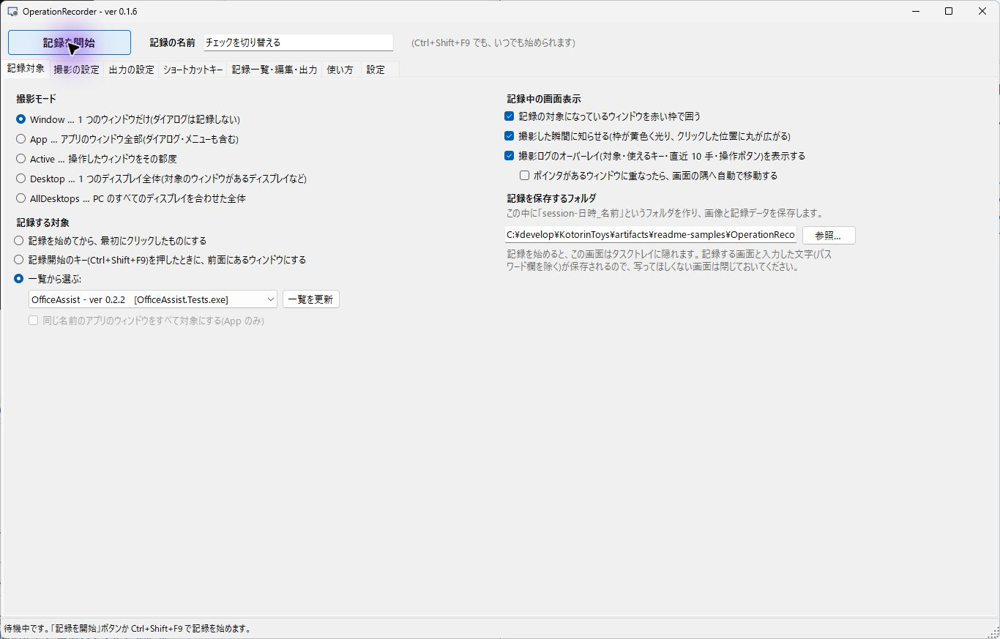
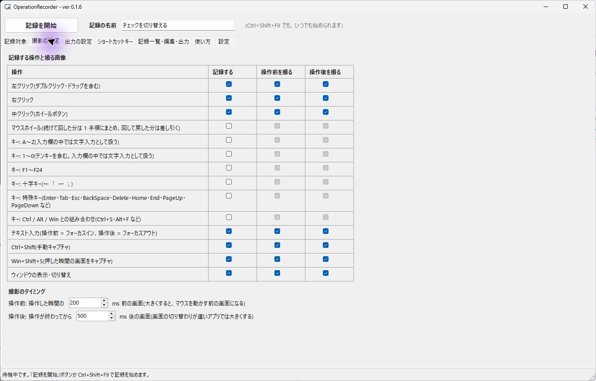
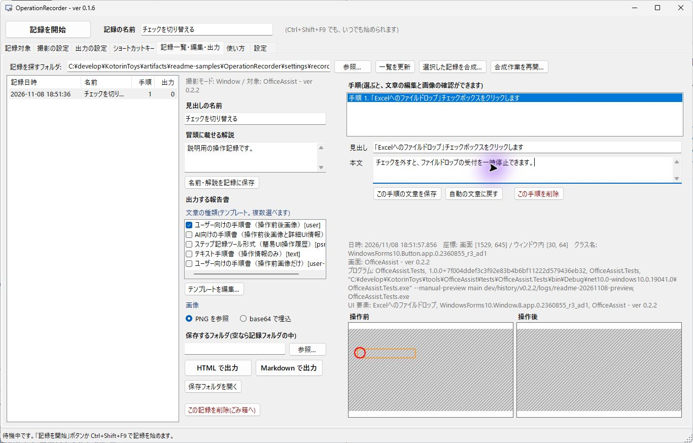
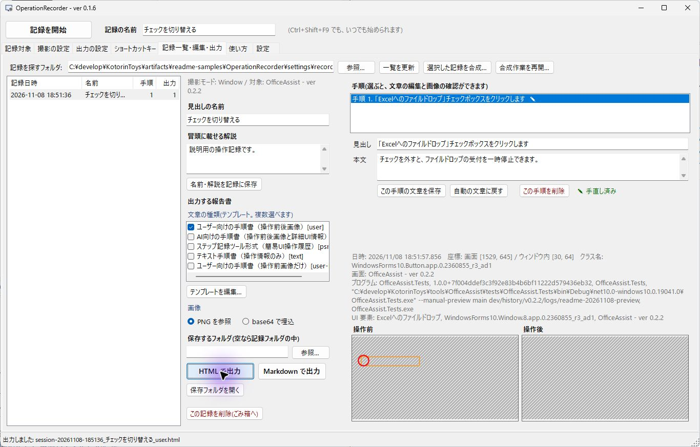
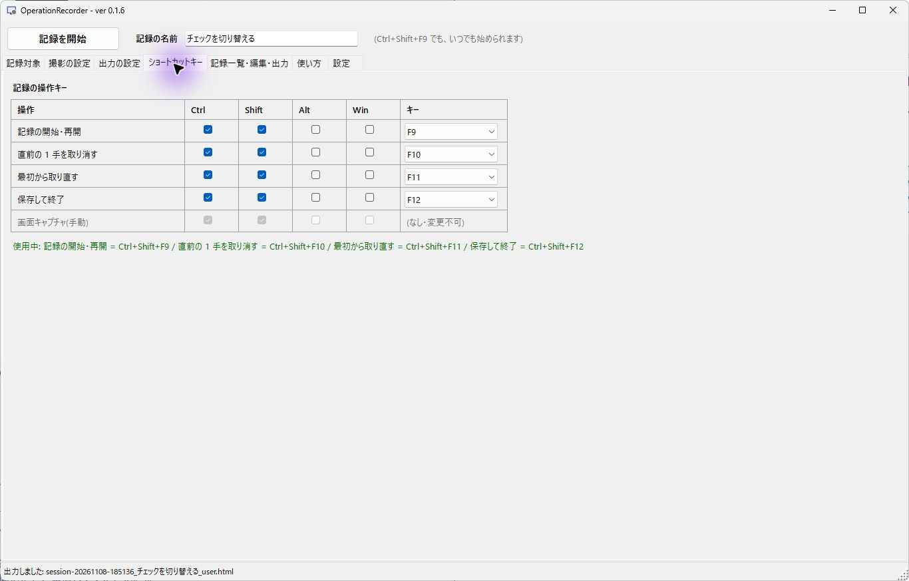

# OperationRecorderの操作手順

起動後、「記録対象」で対象と保存先を選び、記録を開始します。保存した記録は「記録一覧・編集・出力」で編集・合成・出力できます。操作キーは「ショートカットキー」タブで変更できます。

以下は0.1.6の画面です。説明用の設定とOfficeAssistのプレビュー画面を使っています。

## 1. 対象を選ぶ

「記録対象」で撮影モードと対象を選び、記録の名前を入力します。例は1つのウィンドウだけを記録するWindowモードです。「記録を開始」を押すと、この画面は隠れます。

## 2. 撮影条件を確認する

「撮影の設定」で、記録する操作と操作前後の画像を選びます。キー入力やデスクトップ全体を記録すると、意図しない情報も残るため、必要な対象だけを選んでください。

## 3. 記録に説明を加える

対象画面を操作し、Ctrl+Shift+F12で保存します。「記録一覧・編集・出力」で記録と手順を選び、本文を補足して「この手順の文章を保存」を押します。

## 4. 手順書を出力する

テンプレートを選び、「HTMLで出力」または「Markdownで出力」を押します。画面下部の出力完了表示を確認し、「保存フォルダを開く」から成果物を確認できます。

画像の斜線は、対象を覆う別ウィンドウなどの写り込みを防いだ領域です。例では操作の記録・文章編集・出力を説明しています。対象の画面内容も残したい場合は、重なったウィンドウを避けて記録し直してください。

## 5. 操作キーを確認する

「ショートカットキー」で開始・取消・取り直し・保存終了のキーを確認できます。変更するときは他アプリと重複しない組合せを選びます。

## 終了する

画面の×はタスクトレイへの格納です。終了するときはトレイメニュー、またはKotorinToysの「停止」を使います。記録中・保存中は停止を拒否するため、先に記録を保存してください。

詳しい設定は[操作記録マニュアル](USERS_GUIDE.md)を参照してください。
