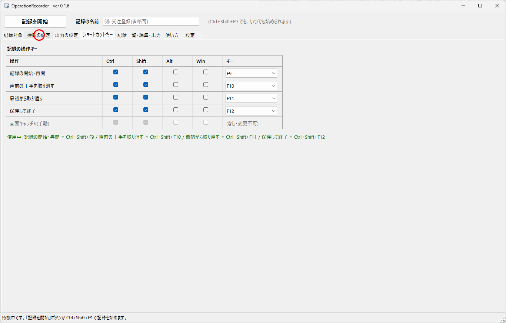
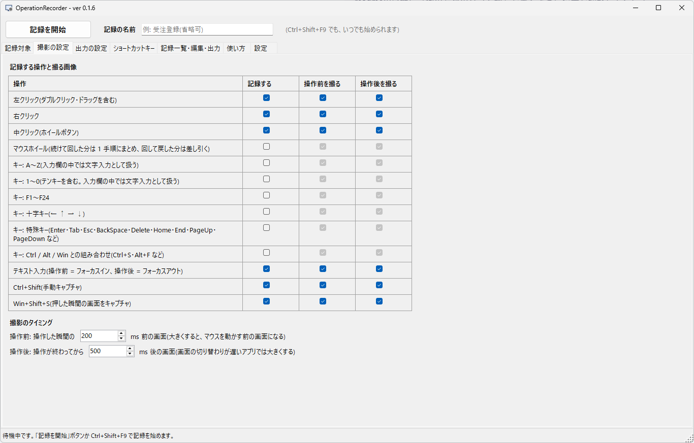
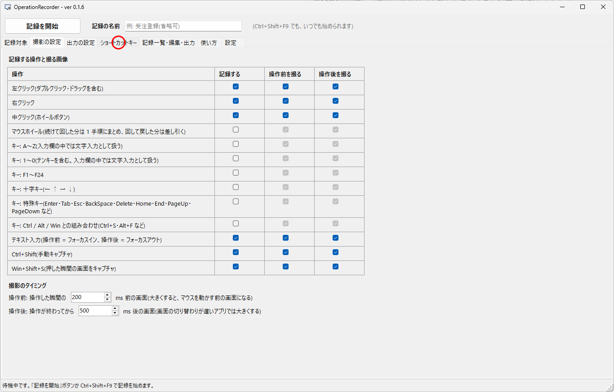
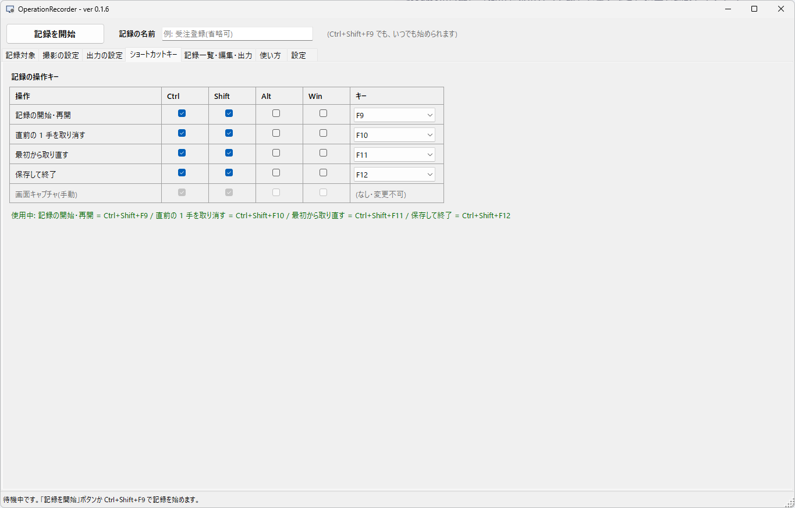

# OperationRecorderの基本設定操作手順書(AI 向け)

本書ではOperationRecorderの基本設定の操作手順について説明する

記録を始める前に、撮影条件と操作キーを確認する例です。

- 記録日時: 2026-11-15 18:24:14 〜 2026-11-15 18:24:19
- 対象: OperationRecorder - ver 0.1.6
- 手順数: 2

## このドキュメントの読み方(AI 向け)

- 各手順の YAML ブロックは、操作を再現するためのデータ。画像は操作前(マウスは押した瞬間、キーは押した瞬間の約 200ms 前)と操作後(マウスはボタンを離してから、キーは押してから約 500ms 後)。
- `kind: input` の手順は、入力欄にフォーカスが入った時点の画面が操作前、フォーカスが外れた時点の画面が操作後。フォーカスを移すためのクリックや Enter / Tab は、別の手順としても記録されている。
- 座標はすべて物理ピクセル(per-monitor DPI aware)。`point.window` は DWM の描画枠(影を含まない実際の見た目)の左上、`point.client` はクライアント領域の左上、`point.screen` は仮想スクリーン座標が原点。
- 要素を特定するときの優先順位: ① `target_uia.automationId` ② ウィンドウ内での `controlType` + `name`(`ancestors` で絞り込む) ③ `target_win32.controlId`(Win32 / WinForms のみ) ④ `point.window` の相対座標。`hwnd` は記録時だけ有効な値なので再現には使わない。
- `input.value` は、フォーカスが外れた時点で入力欄から読み取った値(パスワード欄は値を記録していない)。
- 画像の斜線部分は、対象外のウィンドウが重なっていたため塗りつぶした領域。丸はクリック位置(左ボタン=赤 / 右=青 / 中=緑)、オレンジ枠は操作対象の要素。

## 手順 1. 「撮影の設定」タブをクリックします

操作の種類ごとに「記録する」「操作前を撮る」「操作後を撮る」を確認します。表の下には、操作の何ミリ秒前・後を撮るかを指定する欄があります。

画面: OperationRecorder - ver 0.1.6

| 操作前 | 操作後 |
| --- | --- |
|  |  |

```yaml
seq: 1
kind: click
button: left
time: "2026-11-15T18:24:16.387"
window:
  title: "OperationRecorder - ver 0.1.6"
  className: "WindowsForms10.Window.8.app.0.5c39d4_r3_ad1"
  process: "OperationRecorder.exe"
  frameOnScreen: [597, 256, 1366, 873]
  hwnd: "0x5C00BA"
  program: { name: "OperationRecorder", version: "0.1.6+626bed6b8db0c22e13ab04675e8536fdd6692cd8", company: "OperationRecorder", exe: "OperationRecorder.exe", commandLine: null }
point:
  window: [105, 94]
  client: [104, 63]
  screen: [702, 350]
target_uia:
  controlType: TabItem
  name: "撮影の設定"
  automationId: ""
  className: ""
  frameworkId: "WinForm"
  isEnabled: true
  boundsInWindow: [67, 83, 75, 22]
  ancestors:  # 外側 → 内側
    - { controlType: Window, name: "OperationRecorder - ver 0.1.6", automationId: "", className: "WindowsForms10.Window.8.app.0.5c39d4_r3_ad1" }
    - { controlType: Tab, name: "", automationId: "", className: "WindowsForms10.SysTabControl32.app.0.5c39d4_r3_ad1" }
uiElements: "撮影の設定, WindowsForms10.SysTabControl32.app.0.5c39d4_r3_ad1, OperationRecorder - ver 0.1.6"  # 操作した要素 → 最上位のウィンドウ(名前、無ければクラス名)
target_win32:
  className: "WindowsForms10.SysTabControl32.app.0.5c39d4_r3_ad1"
  controlId: 1
  hwnd: "0x2105F2"
before: { file: "img/0001_before.png", offsetMs: -262, offsetBasis: eventStart, areaOnScreen: [597, 256, 1366, 873], masked: false }
after: { file: "img/0001_after.png", offsetMs: 605, offsetBasis: mouseUp, areaOnScreen: [597, 256, 1366, 873], masked: false }
```

## 手順 2. 「ショートカットキー」タブをクリックします

「記録の開始・再開」と「保存して終了」のキーを確認します。既定値はそれぞれ Ctrl+Shift+F9 と Ctrl+Shift+F12 です。

画面: OperationRecorder - ver 0.1.6

| 操作前 | 操作後 |
| --- | --- |
|  |  |

```yaml
seq: 2
kind: click
button: left
time: "2026-11-15T18:24:18.241"
window:
  title: "OperationRecorder - ver 0.1.6"
  className: "WindowsForms10.Window.8.app.0.5c39d4_r3_ad1"
  process: "OperationRecorder.exe"
  frameOnScreen: [597, 256, 1366, 873]
  hwnd: "0x5C00BA"
  program: { name: "OperationRecorder", version: "0.1.6+626bed6b8db0c22e13ab04675e8536fdd6692cd8", company: "OperationRecorder", exe: "OperationRecorder.exe", commandLine: null }
point:
  window: [263, 94]
  client: [262, 63]
  screen: [860, 350]
target_uia:
  controlType: TabItem
  name: "ショートカットキー"
  automationId: ""
  className: ""
  frameworkId: "WinForm"
  isEnabled: true
  boundsInWindow: [217, 83, 93, 22]
  ancestors:  # 外側 → 内側
    - { controlType: Window, name: "OperationRecorder - ver 0.1.6", automationId: "", className: "WindowsForms10.Window.8.app.0.5c39d4_r3_ad1" }
    - { controlType: Tab, name: "", automationId: "", className: "WindowsForms10.SysTabControl32.app.0.5c39d4_r3_ad1" }
uiElements: "ショートカットキー, WindowsForms10.SysTabControl32.app.0.5c39d4_r3_ad1, OperationRecorder - ver 0.1.6"  # 操作した要素 → 最上位のウィンドウ(名前、無ければクラス名)
target_win32:
  className: "WindowsForms10.SysTabControl32.app.0.5c39d4_r3_ad1"
  controlId: 1
  hwnd: "0x2105F2"
before: { file: "img/0002_before.png", offsetMs: -241, offsetBasis: eventStart, areaOnScreen: [597, 256, 1366, 873], masked: false }
after: { file: "img/0002_after.png", offsetMs: 537, offsetBasis: mouseUp, areaOnScreen: [597, 256, 1366, 873], masked: false }
```
