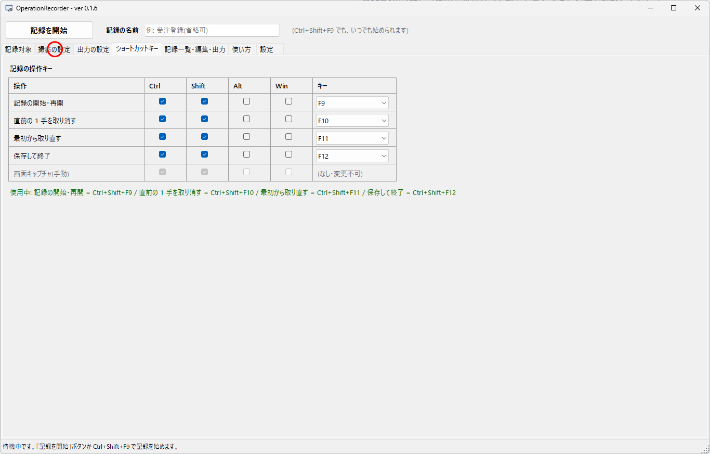
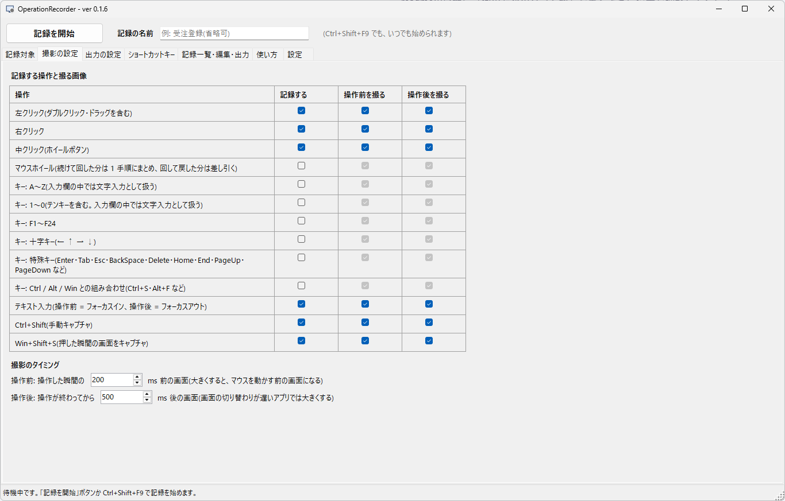
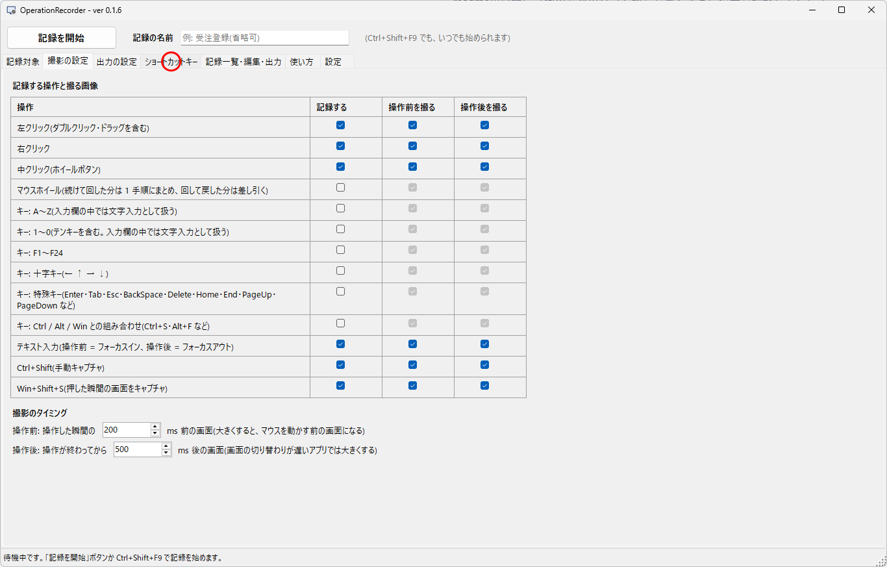
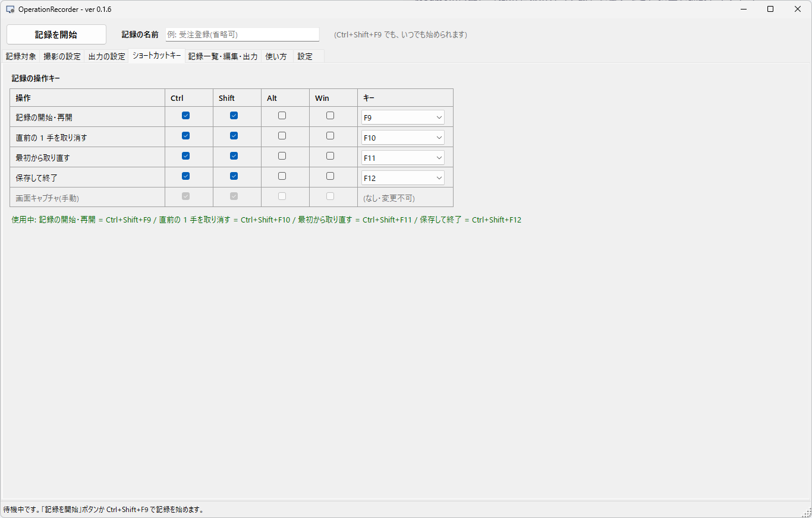

# OperationRecorderの基本設定操作手順書(操作の記録)

本書ではOperationRecorderの基本設定の操作手順について説明する

記録を始める前に、撮影条件と操作キーを確認する例です。

- 記録日時: 2026-11-15 18:24:14 〜 2026-11-15 18:24:19
- 対象: OperationRecorder - ver 0.1.6
- 手順数: 2

## 手順 1: 「撮影の設定 (タブ項目)」をクリック ― ウィンドウ「OperationRecorder - ver 0.1.6」

操作の種類ごとに「記録する」「操作前を撮る」「操作後を撮る」を確認します。表の下には、操作の何ミリ秒前・後を撮るかを指定する欄があります。

- 日時: 2026/11/15 18:24:16.387
- 座標: 画面 [702, 350] / ウィンドウ内 [105, 94]
- プログラム: OperationRecorder, 0.1.6+626bed6b8db0c22e13ab04675e8536fdd6692cd8, OperationRecorder, , OperationRecorder.exe
- UI 要素: 撮影の設定, WindowsForms10.SysTabControl32.app.0.5c39d4_r3_ad1, OperationRecorder - ver 0.1.6

| 操作前 | 操作後 |
| --- | --- |
|  |  |

## 手順 2: 「ショートカットキー (タブ項目)」をクリック ― ウィンドウ「OperationRecorder - ver 0.1.6」

「記録の開始・再開」と「保存して終了」のキーを確認します。既定値はそれぞれ Ctrl+Shift+F9 と Ctrl+Shift+F12 です。

- 日時: 2026/11/15 18:24:18.241
- 座標: 画面 [860, 350] / ウィンドウ内 [263, 94]
- プログラム: OperationRecorder, 0.1.6+626bed6b8db0c22e13ab04675e8536fdd6692cd8, OperationRecorder, , OperationRecorder.exe
- UI 要素: ショートカットキー, WindowsForms10.SysTabControl32.app.0.5c39d4_r3_ad1, OperationRecorder - ver 0.1.6

| 操作前 | 操作後 |
| --- | --- |
|  |  |
