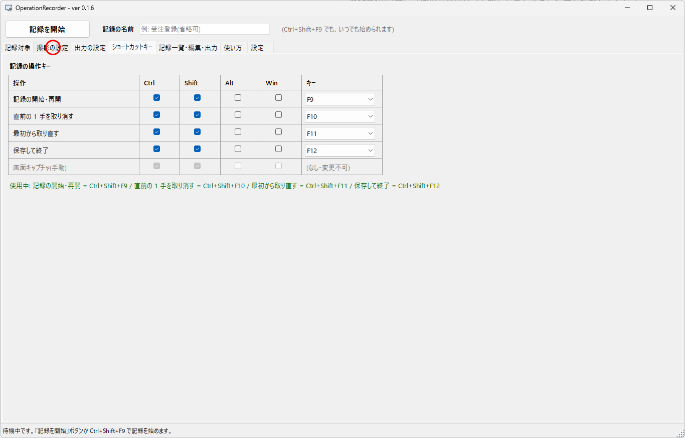
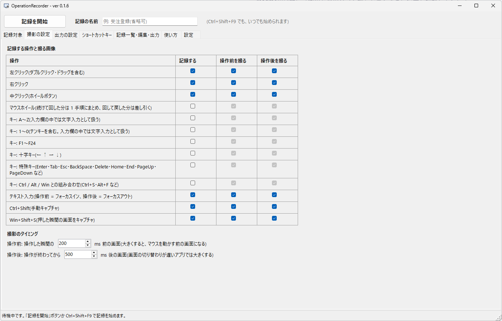
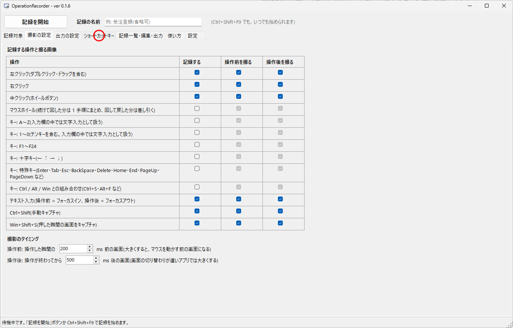
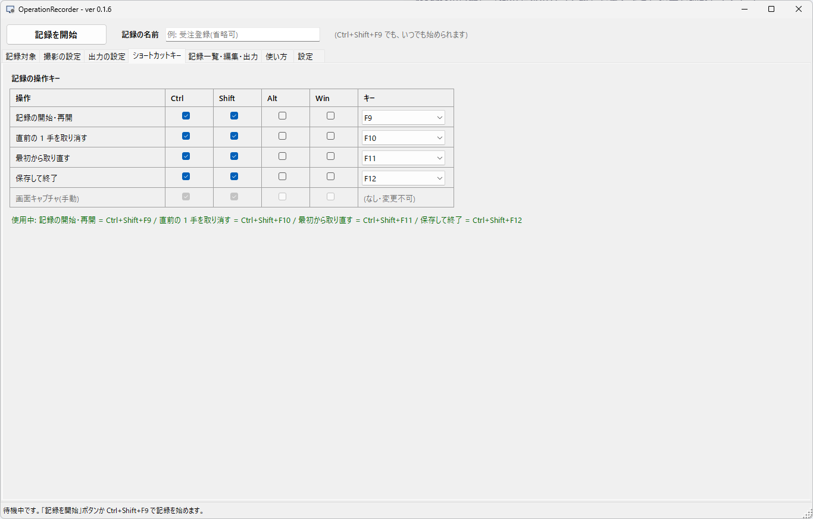

# OperationRecorderの基本設定操作手順書

本書ではOperationRecorderの基本設定の操作手順について説明する

記録を始める前に、撮影条件と操作キーを確認する例です。

## 手順 1. 「撮影の設定」タブをクリックします

操作の種類ごとに「記録する」「操作前を撮る」「操作後を撮る」を確認します。表の下には、操作の何ミリ秒前・後を撮るかを指定する欄があります。

**画面:** OperationRecorder - ver 0.1.6

| 操作前 | 操作後 |
| --- | --- |
|  |  |

## 手順 2. 「ショートカットキー」タブをクリックします

「記録の開始・再開」と「保存して終了」のキーを確認します。既定値はそれぞれ Ctrl+Shift+F9 と Ctrl+Shift+F12 です。

**画面:** OperationRecorder - ver 0.1.6

| 操作前 | 操作後 |
| --- | --- |
|  |  |
